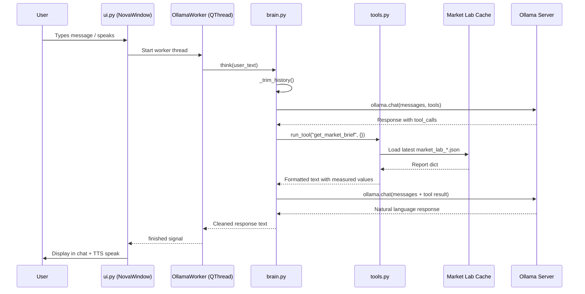
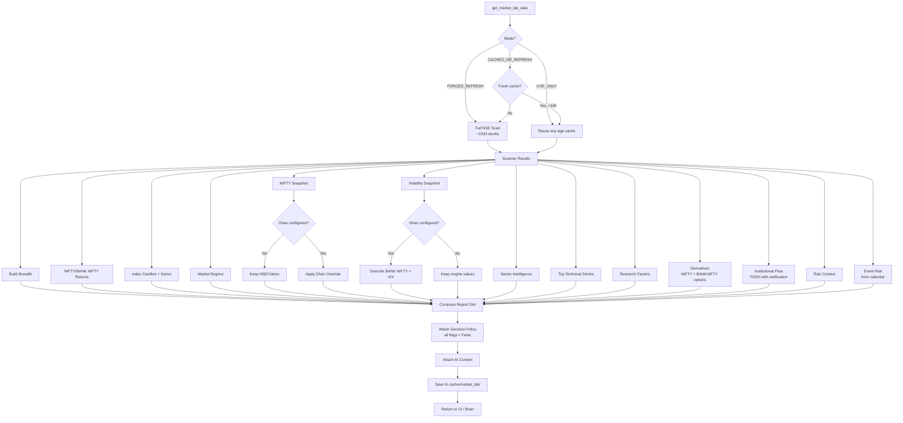
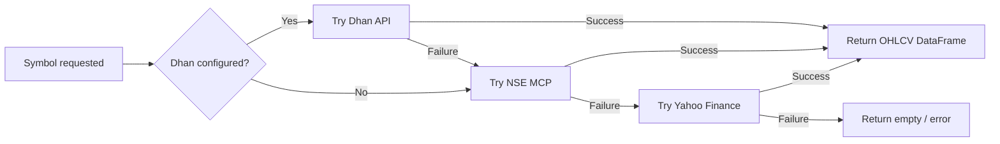
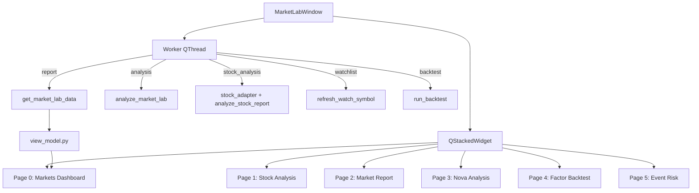

# NOVA PROJECT BRAIN

> Comprehensive codebase discovery and architecture document.
> Generated: 2026-10-31 | Investigator: Claude Opus 4.6 | READ-ONLY audit
> Source: 74 Python files, 44,404 lines of project source, 38 core modules

---

## Table of Contents

1. [Executive Summary](#1-executive-summary)
2. [Project Purpose](#2-project-purpose)
3. [Current Verified Capabilities](#3-current-verified-capabilities)
4. [Project Directory Structure](#4-project-directory-structure)
5. [Architecture Overview](#5-architecture-overview)
6. [Component-by-Component Explanation](#6-component-by-component-explanation)
7. [AI Brain and Model Configuration](#7-ai-brain-and-model-configuration)
8. [AI Tool-Calling Lifecycle](#8-ai-tool-calling-lifecycle)
9. [Market Lab Architecture](#9-market-lab-architecture)
10. [Data-Source Inventory](#10-data-source-inventory)
11. [Data-Flow Diagrams](#11-data-flow-diagrams)
12. [Important Files and Functions](#12-important-files-and-functions)
13. [Dependency Inventory](#13-dependency-inventory)
14. [Testing and Validation Status](#14-testing-and-validation-status)
15. [Known Bugs and Limitations](#15-known-bugs-and-limitations)
16. [Incomplete Features](#16-incomplete-features)
17. [Security Considerations](#17-security-considerations)
18. [Current Project Status](#18-current-project-status)
19. [Recommended Future Development Priorities](#19-recommended-future-development-priorities)
20. [Glossary](#20-glossary)

---

## 1. Executive Summary

Nova is a **local Windows Python desktop application** combining two surfaces:

1. **Nova Assistant** (`main.py` → `ui.py` → `brain.py`): A personal AI command assistant with voice I/O, a 3D visual core, tool calling, and web research.
2. **Nova Market Lab** (`market_lab_ui.py` → `market_lab_data.py`): An Indian-market analysis workbench with 10+ intelligence layers, derivatives analysis, institutional flow tracking, and AI-powered interpretation.

Both surfaces share the `analysis/data/` engine layer and the same local Ollama model (`qwen3.5:4b`). The project is **analysis-only** — no broker connection, no order placement, no trade execution. This boundary is enforced at every layer: engine docstrings, data pipeline constants, report flags, AI system prompts, UI guardrails, and design tokens.

**Scale**: 74 Python source files totaling 44,404 lines across 38 core modules. 20 test files with 394+ offline tests. 109 pinned runtime dependencies.

**Verification status**: All findings below are labeled:
- **VERIFIED** — directly confirmed by reading the source code.
- **PARTIALLY VERIFIED** — some implementation exists, but the full behavior is uncertain.
- **UNVERIFIED** — cannot be established from the available code.

---

## 2. Project Purpose

### In Simple Language

Nova is Anirudh's personal AI assistant and Indian stock market research workbench. Think of it as two tools in one project:

**Tool 1 — The Assistant**: You talk to Nova (by voice or text), and it talks back. It can tell you the time, open apps, search the web, and give you a morning market brief about what happened in the Indian stock market. It runs on your Windows PC using a local AI model (no cloud needed).

**Tool 2 — Market Lab**: A financial terminal that collects data about the Indian stock market (NIFTY 50, BANK NIFTY, India VIX, 2,333 individual stocks) and presents it in a Bloomberg/TradingView-style dashboard. It shows what the market is doing (regime, breadth, volatility), what institutional investors are doing (FII/DII flows), what derivatives traders are positioning for (options OI, max pain), and which stocks are trending. An AI layer interprets the raw data into a human-readable assessment.

**What makes Nova different from a normal chatbot**: Nova doesn't just talk — it has tools. When you ask about the market, it doesn't guess; it calls real data engines that fetch live NSE data, compute indicators, and return measured values. The AI only interprets what the engines measure. It never invents a number.

**The safety line**: Nova analyzes. It never trades. There is no broker connection, no order button, no way to execute a trade. This is enforced in code at every layer, not just by policy.

### Technical Purpose

Nova serves as:
- A local-first AI command interface backed by Ollama (no cloud API dependency).
- An integrated Indian market intelligence platform combining 10+ analysis engines.
- A cache-first data architecture that avoids expensive NSE scans unless explicitly requested.
- A demonstration of evidence-grounded AI: the LLM interprets measured data, never fabricates values.

---

## 3. Current Verified Capabilities

| Capability | Surface | Status |
|---|---|---|
| Natural language chat with local LLM | Assistant | **VERIFIED** |
| Voice input via wake phrase ("Hi Nova") | Assistant | **VERIFIED** |
| Text-to-speech responses (Piper TTS) | Assistant | **VERIFIED** |
| 3D animated visual core (particles, rings, orb) | Assistant | **VERIFIED** |
| Open whitelisted apps (notepad, chrome, vscode, etc.) | Assistant | **VERIFIED** |
| Open URLs in browser | Assistant | **VERIFIED** |
| Web research via local SearXNG | Assistant | **VERIFIED** |
| YouTube search | Assistant | **VERIFIED** |
| Morning market brief (cache-first) | Assistant | **VERIFIED** |
| Full NSE market analysis (cache-first) | Assistant | **VERIFIED** |
| Real-time NIFTY 50 / BANK NIFTY / India VIX dashboard | Market Lab | **VERIFIED** |
| Candlestick charts with MA overlays (PyQtGraph) | Market Lab | **VERIFIED** |
| Market breadth analysis (advances/declines/EMA%) | Market Lab | **VERIFIED** |
| Market regime classification (BULLISH → BEARISH) | Market Lab | **VERIFIED** |
| Sector rotation intelligence (13 NSE sectors) | Market Lab | **VERIFIED** |
| Derivatives analysis (OI PCR, max pain, IV, walls) | Market Lab | **VERIFIED** |
| Institutional flow tracking (FII/DII with source verification) | Market Lab | **VERIFIED** |
| Volatility regime (ATR, realized vol, VIX percentile) | Market Lab | **VERIFIED** |
| Event risk calendar and assessment | Market Lab | **VERIFIED** |
| Factor ranking (momentum, trend, relative strength) | Market Lab | **VERIFIED** |
| Per-stock AI research reports | Market Lab | **VERIFIED** |
| Watchlist with real-time refresh | Market Lab | **VERIFIED** |
| Factor backtest harness | Market Lab | **VERIFIED** |
| Optional Dhan live data override | Market Lab | **VERIFIED** |
| Preflight health checker (Ollama/SearXNG) | Launcher | **VERIFIED** |
| Offline test suite (394+ tests) | Tests | **VERIFIED** |
| CI syntax gate (GitHub Actions) | CI | **VERIFIED** |

---

## 4. Project Directory Structure

```
C:\Users\Anirudh\nova\
├── main.py                          # Nova Assistant entry point (24 lines)
├── ui.py                            # Assistant PySide6 window (2,546 lines)
├── brain.py                         # Ollama chat + tool-calling loop (267 lines)
├── tools.py                         # Tool registry + market analysis (1,778 lines)
├── nova3dcore.py                    # PyOpenGL 3D visual core (1,227 lines)
├── voice.py                         # Faster-Whisper STT session system (1,329 lines)
├── tts.py                           # Piper TTS playback (143 lines)
├── research.py                      # Web-research classifier (71 lines)
├── start_nova.py                    # Launcher with preflight (158 lines)
├── market_lab_ui.py                 # Market Lab PySide6 window (3,862 lines)
│
├── market_lab/                      # Market Lab module
│   ├── __init__.py
│   ├── market_lab_data.py           # Central analysis gateway (4,920 lines) ← LARGEST
│   ├── market_lab_brain.py          # Ollama interpretation layer (844 lines)
│   ├── view_model.py                # Presentation adapter (739 lines)
│   ├── widgets.py                   # PySide6 component library (1,715 lines)
│   ├── stock_adapter.py             # Per-stock analysis adapter (346 lines)
│   ├── report_parser.py             # AI report text parser (177 lines)
│   ├── theme.py                     # QSS theme loader (89 lines)
│   └── icons.py                     # Inline Lucide-style SVG icons (128 lines)
│
├── analysis/
│   ├── data/                        # Analysis engines
│   │   ├── __init__.py
│   │   ├── nse_feed.py              # Indian Market MCP adapter (1,603 lines)
│   │   ├── symbol_master.py         # NSE equity master cache (516 lines)
│   │   ├── market_universe.py       # NSE→Dhan→Yahoo resolution layer (1,558 lines)
│   │   ├── market_data.py           # Direct yfinance helpers (129 lines)
│   │   ├── market_scanner.py        # Full NSE scanner + ranking (2,488 lines)
│   │   ├── technical_engine.py      # RSI/MACD/EMA/ATR/trend (1,337 lines)
│   │   ├── volatility_engine.py     # Volatility/VIX analysis (1,017 lines)
│   │   ├── derivatives_engine.py    # Options chain analysis (3,404 lines)
│   │   ├── institutional_flow_engine.py  # FII/DII flows (2,742 lines)
│   │   ├── sector_classification.py # Sector mapping (2,151 lines)
│   │   ├── sector_engine.py         # Stock-level sector intelligence (2,859 lines)
│   │   ├── risk_engine.py           # Market risk context (596 lines)
│   │   ├── event_risk_engine.py     # Event-risk from calendar (727 lines)
│   │   ├── research_factor_engine.py # Cross-sectional factor ranking (325 lines)
│   │   ├── watchlist_engine.py      # Per-symbol watchlist refresh (157 lines)
│   │   ├── dhan_feed.py             # Optional Dhan adapter (619 lines)
│   │   └── cache/                   # Generated caches (git-ignored)
│   │       ├── scanner/             # market_scan_*.csv
│   │       ├── sector/              # sector_scan_*.csv, classification
│   │       ├── market_lab/          # market_lab_*.json (full reports)
│   │       ├── dhan/                # Dhan instrument master + candles
│   │       ├── institutional_flow/  # FII/DII history sessions
│   │       ├── derivatives/         # Options chain cache
│   │       └── volatility/          # Volatility snapshots
│   ├── regime/
│   │   └── regime_engine.py         # 100-point market regime composite (360 lines)
│   ├── sectors/
│   │   └── sector_engine.py         # Sectoral index rotation analysis (882 lines)
│   └── backtest_harness.py          # Factor backtest scoring (351 lines)
│
├── styles/
│   ├── design_tokens.py             # Centralized design system tokens (220 lines)
│   └── nova_theme.qss               # Shared QSS stylesheet
│
├── ui/
│   └── theme.py                     # Nova Assistant theme loader
│
├── tests/                           # 20 test files, 394+ tests (all offline)
│   ├── test_engine_math.py
│   ├── test_gui_smoke.py            # Headless GUI tests (largest test file)
│   ├── test_view_model.py
│   ├── test_dhan_feed.py
│   ├── test_cached_market_analysis.py
│   ├── test_stock_adapter.py
│   ├── test_backtest_harness.py
│   ├── test_market_lab_brain.py
│   ├── test_sector_engine.py
│   ├── test_pipeline_integration.py
│   ├── test_market_lab_data.py
│   ├── test_market_brief.py
│   ├── test_tool_contract.py
│   ├── test_watchlist_engine.py
│   ├── test_start_nova.py
│   ├── test_report_parser.py
│   ├── test_research_factor_engine.py
│   ├── test_theme.py
│   ├── test_institutional_flow_coverage.py
│   └── test_packaging.py
│
├── analysis/data/event_calendar.json  # User-maintained event calendar
├── requirements.txt                   # 109 pinned packages (Python 3.14)
├── pyproject.toml                     # Metadata mirror (no build-system)
├── .github/workflows/ci.yml          # Dependency-free CI gate
├── .gitignore                         # Covers venvs, caches, secrets, artifacts
│
├── check_event_calendar.py            # Calendar inspector
├── touch_event_calendar.py            # Calendar re-stamp tool
├── mic_test.py                        # Microphone diagnostics
├── test_nse_mcp.py                    # NSE MCP integration test
├── test_nse_tools.py                  # NSE tools validation
│
├── stt_models/                        # Faster-Whisper model files (local)
├── voices/                            # Piper TTS voice assets (local)
├── venv/                              # Active virtual environment (109 packages)
└── .venv/                             # Empty secondary venv (unused)
```

### Historical / Backup Artifacts (from copy-paste era)

| File | Purpose | Status |
|---|---|---|
| `market_lab_ui_backup.py` | Old Market Lab UI before terminal redesign | Committed |
| `market_lab/market_lab_data.before_institutional_flow.py` | Snapshot before institutional flow wiring | Committed |
| `market_lab/market_lab_data.before_source_quality.py` | Snapshot before source quality pass | Committed |
| `analysis/data/institutional_flow_engine.before_groww_html.py` | Pre-Groww HTML parser version | Committed |
| `analysis/data/institutional_flow_engine.before_source_quality.py` | Pre-source quality version | Committed |
| `apply_institutional_flow_patch.py` | One-shot patch script (already applied) | Committed |
| `market_analysis_inspection.txt` | Inspection notes from early audit | Committed |
| `market_lab_brain_inspection.txt` | Brain module inspection notes | Committed |
| `market_lab_data_inspection.txt` | Data module inspection notes | Committed |
| `tool_registry_inspection.txt` | Tool registry inspection notes | Committed |
| `test_output*.txt` (15 files) | Test capture outputs | Untracked |

**VERIFIED**: AGENTS.md states: "preserve them unless the user explicitly asks for cleanup." With Git history now available, these are candidates for removal.

---

## 5. Architecture Overview

### High-Level Architecture

**VERIFIED**: Nova follows two parallel call graphs sharing the `analysis/data/` engine layer.

```
┌─────────────────────────────────┐   ┌────────────────────────────────────────────┐
│        NOVA ASSISTANT           │   │           NOVA MARKET LAB                  │
│                                 │   │                                            │
│  main.py                        │   │  market_lab_ui.py                          │
│    └─ ui.py (NovaWindow)        │   │    ├─ market_lab_data.py (data pipeline)   │
│         ├─ brain.py (Ollama)    │   │    │    └─ [ALL analysis engines]           │
│         │    └─ tools.py        │   │    ├─ market_lab_brain.py (Ollama AI)      │
│         ├─ voice.py (STT)       │   │    ├─ view_model.py (presentation)         │
│         ├─ tts.py (TTS)         │   │    ├─ stock_adapter.py (per-stock)         │
│         └─ nova3dcore.py (3D)   │   │    ├─ report_parser.py (AI text)           │
│                                 │   │    └─ widgets.py (UI components)           │
└────────┬────────────────────────┘   └────────┬───────────────────────────────────┘
         │                                     │
         └──────────────┬──────────────────────┘
                        │
              ┌─────────▼──────────┐
              │  analysis/data/    │
              │  (shared engines)  │
              │                    │
              │  technical_engine  │
              │  market_scanner    │
              │  derivatives_engine│
              │  inst_flow_engine  │
              │  sector_engine     │
              │  volatility_engine │
              │  risk_engine       │
              │  event_risk_engine │
              │  factor_engine     │
              │  nse_feed (MCP)    │
              │  dhan_feed (opt)   │
              │  market_universe   │
              │  symbol_master     │
              └────────────────────┘
```

### Key Architectural Properties

1. **Separation of measured data and interpretation** [VERIFIED]: Data engines produce measured values; the Ollama brain only interprets them. The brain never overwrites engine output.

2. **Cache-first data flow** [VERIFIED]: Normal mode reuses cached scanner CSVs (16-hour freshness gate). Only `--refresh` triggers the expensive ~2,333-stock NSE scan.

3. **Graceful degradation** [VERIFIED]: Every engine import is wrapped in try/except with `*_IMPORT_OK` flags. Missing engines degrade to "NOT AVAILABLE" rather than crashing.

4. **Thread isolation** [VERIFIED]: Heavy work (scans, Ollama calls) runs on `QThread` workers. The UI thread only updates widgets from signals.

5. **Layered safety** [VERIFIED]: The analysis-only boundary is enforced in engine docstrings, pipeline constants, report flags, AI prompts, UI guardrails, and design tokens simultaneously.

---

## 6. Component-by-Component Explanation

### 6.1 Entry Points

#### `main.py` (24 lines) [VERIFIED]
Creates a `QApplication`, sets the Fusion style, instantiates `NovaWindow` from `ui.py`, and enters the Qt event loop. The application name is "Nova — Personal AI Command System".

#### `market_lab_ui.py` (3,862 lines) [VERIFIED]
Creates a `QApplication`, instantiates `MarketLabWindow`, loads the QSS theme via `market_lab/theme.py`, and enters the Qt event loop. The window title is "NOVA MARKET LAB".

#### `start_nova.py` (158 lines) [VERIFIED]
A launcher with advisory preflight checks for Ollama (`http://localhost:11434/api/tags`) and SearXNG (`http://localhost:8080`). Supports `main`, `market`, `--check` (exit 0/1), and interactive menu. Never blocks a launch — only warns.

### 6.2 The Assistant Surface

#### `ui.py` (2,546 lines) — `NovaWindow` [VERIFIED]
Main PySide6 window with three conceptual columns:
- **Left**: System telemetry panel (CPU, RAM, network, GPU via `nvidia-smi`, uptime, Ollama/SearXNG status)
- **Center**: 3D visual core (`Nova3DCore` QOpenGLWidget), text input, voice/send buttons
- **Right**: Chat scroll area showing conversation history

Key internal mechanics:
- `OllamaWorker(QThread)`: Runs `brain.think()` off the UI thread; emits `finished(str)` or `error(str)`.
- `VoiceWorker(QThread)`: Runs `voice.listen_for_session_event()` in a loop; emits transcribed text.
- `ServiceCheckWorker(QThread)`: Probes Ollama and SearXNG availability.
- Timer-driven telemetry: Updates CPU/RAM/network every few seconds via `psutil`.
- Design tokens imported from `styles/design_tokens.py`; theme applied via `ui/theme.py`.

#### `brain.py` (267 lines) — Ollama Chat Loop [VERIFIED]
The complete AI execution loop. See Section 7 for full details.

#### `tools.py` (1,778 lines) — Tool Registry [VERIFIED]
Contains 10 callable tools, their JSON schemas for Ollama, and the `run_tool()` dispatcher. See Section 8 for the full tool-calling lifecycle.

#### `voice.py` (1,329 lines) — Voice Session System [VERIFIED]
Implements a state machine: IDLE → LISTENING → ACTIVE_CONVERSATION.
- Engine: Faster-Whisper (`systran/faster-whisper-small`, local files under `stt_models/`)
- Wake phrase: "Hi Nova" or "Hey Nova"
- Deactivation: "Bye Nova" / "See you Nova"
- Adaptive microphone noise detection using `silero-vad` for VAD and `sounddevice` for capture
- Natural speech start/end detection (silence threshold triggers end of utterance)
- CPU-friendly (no GPU required); in-memory transcription (no temp audio files)

#### `tts.py` (143 lines) — Text-to-Speech [VERIFIED]
- Engine: Piper TTS (`piper-tts` 1.8.0)
- Voice: `en_US-lessac-high` (ONNX model under `voices/`)
- Playback: `winsound` (Windows-only, synchronous blocking playback)
- Thread-safe with `threading.Lock` (`_AUDIO_LOCK`)
- Validates voice model file existence before speaking
- Writes temp `.wav` files that are cleaned up after playback

#### `nova3dcore.py` (1,227 lines) — 3D Visual Core [VERIFIED]
A `QOpenGLWidget` subclass using immediate-mode PyOpenGL rendering:
- Central glowing orb with pulsing opacity
- Wireframe sphere (latitude/longitude lines)
- Two orbital rings rotating at different speeds
- Ambient particle field (40+ particles in orbital motion)
- Neural network visualization (nodes and edges)
- Energy glow effect (additive blended quads)
- 6 visual states: IDLE, LISTENING, THINKING, SPEAKING, ERROR, TOOL_CALL
- Color scheme: cyan/teal/green/purple; background `#020408`
- 60fps animation driven by `QTimer` (16ms interval)

#### `research.py` (71 lines) — Web Research Classifier [VERIFIED]
`classify(text)` returns `'tool'`, `'web'`, or `'unsure'` using regex-based heuristics. Imported by `brain.py` (though the import was not observed in the current `brain.py` — it is used by `tools.py` for `web_research`). Detects requests that need live information (news, prices, weather, scores) vs. ones handled by existing tools (time, YouTube, app launch).

### 6.3 The Market Lab Surface

#### `market_lab/market_lab_data.py` (4,920 lines) — Central Data Pipeline [VERIFIED]
The single largest file and the **central nervous system** of Nova's analytical capability. Orchestrates all analysis engines into a single report dict. See Section 9 for full architecture.

#### `market_lab/market_lab_brain.py` (844 lines) — AI Interpretation [VERIFIED]
Two AI functions backed by Ollama:
- `analyze_market_lab(query, force_refresh)`: Full market or single-stock AI assessment
- `analyze_stock_report(symbol, metrics, candles, report, mode)`: Focused per-stock report

See Section 7 for model configuration and prompt design.

#### `market_lab/view_model.py` (739 lines) — Presentation Adapter [VERIFIED]
Pure, stdlib-only module. Translates the raw report dict into UI-friendly structures. Every missing field becomes an explicit `N/A` — never a fabricated value. Key functions:
- `index_card(report, which)`: NIFTY/BANK NIFTY/VIX card data
- `indicator_cards(report, which)`: RSI/MACD/ATR/VOL (computed from candles via technical_engine)
- `breadth_block(report)`: Advances/declines/EMA breadth
- `vix_card(report)`: India VIX with session changes
- `sector_summary(report)`, `uptrend_summary(report)`, `flow_series(report)`, `risk_cards(report)`, `factor_summary(report)`

#### `market_lab/widgets.py` (1,715 lines) — Component Library [VERIFIED]
Self-contained PySide6 components: `panel()`, `stat_chip()`, `FreshnessBadge`, `CollapsibleSection`, `CandleChart` (QPainter), `LineChart`, `PgCandleChart` (PyQtGraph with price/volume/RSI/MACD panels), `PerfBar`, `FillBar`, `StackBar`, `GroupedBarChart`, `GridBackground`, `GuardrailsBar`, `KeyValueTable`.

#### `market_lab/stock_adapter.py` (346 lines) — Per-Stock Adapter [VERIFIED]
Read-only adapter for individual stock analysis:
- `resolve_symbol(query)`: Matches against NSE equity master
- `stock_metrics(symbol)`: Technical indicators via `technical_engine.analyze_stock()`
- `stock_candles(symbol, period)`: OHLCV + real MA20/50/200
- `stock_oscillators(candles)`: RSI/MACD series from candles
- `stock_observations(metrics)`: Key observations derived from present metrics
- `stock_sector(symbol)`: Sector lookup
- `kpi_tiles(metrics)`, `data_quality(metrics, candles)`

#### `market_lab/report_parser.py` (177 lines) — AI Report Parser [VERIFIED]
Parses the AI research report text into structured sections, extracts bias (BULLISH/BEARISH/NEUTRAL/MIXED/INSUFFICIENT EVIDENCE), and identifies key price levels. Always preserves the raw text as fallback.

#### `market_lab/theme.py` (89 lines) — Theme Loader [VERIFIED]
`load_theme()` resolves `styles/nova_theme.qss` from the project root via `Path(__file__).parent.parent`. Returns empty string on missing file (never breaks startup).

#### `market_lab/icons.py` (128 lines) — Icon Set [VERIFIED]
16 inline Lucide-style SVG icons rendered via QtSvg. Falls back to text-only when QtSvg is missing.

### 6.4 The Analysis Engine Layer

See Section 9 for the complete Market Lab data pipeline and Section 12 for key functions.

### 6.5 Design System

#### `styles/design_tokens.py` (220 lines) [VERIFIED]
Single source of truth for the visual language:
- Colors: BG `#050B10`, SURFACE `#091620`, SIDEBAR `#061019`, TEXT `#F2F6FA`, GREEN `#00E6A0`, RED `#FF4058`, AMBER `#FFBD4A`, BLUE `#3198FF`, CYAN `#00D9F5`, PURPLE `#B49AFF`
- Typography: Segoe UI (body), Consolas (monospace); sizes from caption (9px) to xlarge (20px)
- Spacing: xs (4px) to xxl (32px)
- Guardrail constants: `GUARDRAIL_TEXT`, `BUY_SELL_AUTHORIZED = False`, `TRADING_EXECUTION = False`, `SIGNAL_ELIGIBLE = False`
- Freshness functions: `freshness_level()`, `freshness_color()`, `freshness_label()` with tier thresholds (green <10m, amber <2h, red <12h, critical >12h)

Both `ui.py` and `market_lab_ui.py` import tokens from this file, ensuring visual consistency across surfaces.

---

## 7. AI Brain and Model Configuration

### 7.1 Two AI Brains

Nova has two independent Ollama-backed AI brains that share the same local model but serve different purposes:

| Parameter | Assistant Brain (`brain.py`) | Market Lab Brain (`market_lab_brain.py`) |
|---|---|---|
| **Model** | `qwen3.5:4b` | `qwen3.5:4b` |
| **Context window** | 4,096 tokens | 8,192 tokens |
| **Temperature** | 0.3 | 0.2 |
| **Keep-alive** | 30 minutes | 30 minutes |
| **Hidden reasoning** | Stripped (`<think>` tags removed via regex) | Disabled (`think=False`) |
| **Tool calling** | Yes (10 tools) | No (data pre-assembled) |
| **History** | Module-level list, max 20 messages | Single-turn (no conversation memory) |
| **Provider** | `ollama` Python client | `ollama` Python client |

### 7.2 Assistant Brain — System Prompt (`brain.py:27-57`) [VERIFIED]

The full system prompt:

> You are Nova, a personal AI assistant for Ani. Speak naturally, clearly, and confidently, like a capable personal assistant. Reply in 1-2 short spoken sentences unless asked for detail. Plain text only: no markdown, no emojis, no lists. For current or factual information that can be obtained from an available tool, use the appropriate tool instead of guessing. For current time or date, always call get_time; never guess. For current market prices, indices, financial data, or other live market information, you MUST call the appropriate market-data tool before answering. For NIFTY 50 price, closing price, open, high, low, or today's market value, you MUST call get_market_data. Never answer a market-price question from memory. Never invent, estimate, or substitute a market number. Report market values returned by the tool exactly. If a tool fails or an app is unsupported, say so honestly.

Key design choices:
- Plain text output (designed for voice synthesis, not visual display)
- Mandatory tool use for live data (time, market values)
- Zero-tolerance for fabricated numbers

### 7.3 Assistant Brain — Chat Loop (`brain.py:173-267`) [VERIFIED]

```
think(user_text)
│
├─ _trim_history()          # Keep ≤20 messages after system prompt
├─ Append user message
│
├─ FOR up to MAX_TOOL_ROUNDS (3):
│   ├─ _chat(tools=TOOL_SCHEMA)    # Call Ollama with tool definitions
│   ├─ IF no tool_calls → return cleaned response
│   └─ FOR each tool_call:
│       ├─ Extract function name + arguments
│       ├─ run_tool(name, args)     # Safe execution via tools.py
│       └─ Append tool result to history
│
├─ After max rounds: _chat(tools=None)  # Final response without tools
│
└─ On ANY error: roll back history to pre-message state
```

History management: Module-level `history` list initialized with the system prompt. `_trim_history()` keeps the most recent `MAX_HISTORY` (20) messages, always starting from a `user` role message.

Error handling: `BrainError` for user-readable errors (Ollama unreachable, model not installed). On any error, `history` is rolled back to its state before the user message was appended, preventing corrupted conversation context.

### 7.4 Market Lab Brain — System Prompt (`market_lab_brain.py:37-225`) [VERIFIED]

The Market Lab SYSTEM_PROMPT is 186 lines — the most detailed prompt in the project. It specifies:

1. **Identity**: "Nova Market Lab Brain, an evidence-grounded Indian market analysis assistant"
2. **10 coverage requirements**: regime, NIFTY, BANK NIFTY, breadth, volatility, sectors, derivatives, institutional flows, conflicting evidence, risks
3. **15+ evidence rules**:
   - Use ONLY data from the supplied report
   - Preserve numerical values, signs, units, dates, and periods exactly
   - Never treat unavailable data as zero or neutral
   - Distinguish measured data from interpretation
   - Never invent price levels, indicators, returns, flows, targets, or probabilities
   - Flag discrepancies between conflicting fields
   - A positioning label or technical score is NOT a standalone signal
4. **Single-stock question handling**: Focused directive for per-stock queries (uses verified per-stock evidence from watchlist engine)
5. **Safety enforcement**: "No broker connection, trade execution, or automatic orders. Never claim an order was placed."
6. **Output structure template**: Prescribed sections for the AI to follow

### 7.5 Stock Analysis Brain — System Prompt (`market_lab_brain.py:680`) [VERIFIED]

The `STOCK_SYSTEM_PROMPT` focuses on single-stock equity research:
- Restricted to the ONE stock asked about
- Prohibits fabricating prices, targets, or probabilities
- Requires "INSUFFICIENT EVIDENCE" verdict when data is unavailable
- Three analysis modes: `quick` (brief), `full` (comprehensive), `institutional` (professional-grade)
- Mandatory disclaimer: "AI-generated analysis based on available market data. For informational and educational purposes only."

### 7.6 Model Initialization [VERIFIED]

Both brains use the `ollama` Python client's `ollama.chat()` function. No explicit model initialization or loading step — the Ollama server manages model loading. The `keep_alive="30m"` parameter keeps the model in memory for 30 minutes after each call.

`brain.warmup()` sends a single-token request ("hi", `num_predict=1`) to pre-load the model into Ollama's memory without affecting conversation history.

### 7.7 Model Switching [VERIFIED]

The model name is a module-level constant (`MODEL = "qwen3.5:4b"`) in both `brain.py:14` and `market_lab_brain.py`. There is no UI for model selection and no configuration file override. Switching models requires editing these two constants. The architecture supports any Ollama model that handles tool calling (for the assistant) or long-context analysis (for Market Lab).

---

## 8. AI Tool-Calling Lifecycle

### 8.1 Tool Registry (`tools.py`) [VERIFIED]

The tool registry defines 10 functions available to the assistant brain:

| Tool | Signature | Purpose | Data Source |
|---|---|---|---|
| `get_time()` | No args | Current local date and time | `datetime` stdlib |
| `get_market_data()` | No args | NIFTY 50 latest price/OHLC/change | Yahoo Finance (`yfinance`) |
| `get_market_analysis()` | No args | Full NSE market analysis | Cache-first from saved Market Lab report |
| `get_market_brief()` | No args | Morning market brief | Cache-first from saved Market Lab report |
| `get_market_lab_analysis(query)` | Optional query string | AI interpretation of market data | Ollama via `market_lab_brain` |
| `open_website(url)` | URL string | Open URL in default browser | `webbrowser.open()` |
| `open_app(name)` | App name string | Launch whitelisted Windows apps | `subprocess.Popen()` |
| `search_web(query)` | Query string | Web search via SearXNG | Local SearXNG (`localhost:8080`) |
| `search_youtube(query)` | Query string | YouTube search in browser | `webbrowser.open()` |
| `web_research(query)` | Query string | Deep web research | SearXNG + page scraping |

### 8.2 Tool Safety (`tools.py:run_tool`) [VERIFIED]

`run_tool(name, args)` is the centralized dispatcher. Safety mechanisms:
- **Never raises**: Returns error text instead of propagating exceptions into the chat loop
- **Argument normalization**: Accepts `args` as dict or JSON string; malformed args → `{}`
- **App whitelist** (`tools.py`): Only `notepad`, `calc`, `chrome`, `vscode`, `explorer`, `paint`, `terminal`, `cmd`
- **URL validation**: Only `http://` and `https://` schemes accepted
- **No side effects for market tools**: All market tools are read-only

### 8.3 Market Analysis Tool — Evidence Contract [VERIFIED]

`get_market_analysis()` (`tools.py:886`) reads the latest saved Market Lab JSON report from `analysis/data/cache/market_lab/` and formats a structured evidence contract with sections:

1. Regime/breadth/NIFTY/BANK NIFTY benchmarks
2. VIX and volatility context
3. Derivatives (NIFTY/BANKNIFTY OI PCR, max pain, IV, walls)
4. Institutional flow (FII/DII 5D/10D/20D, regime, signal eligibility)
5. Event risk
6. Top technical stocks
7. Sector intelligence
8. Data availability matrix

Every value is labeled: `VERIFIED` (from engine), `CALCULATED` (derived), or `NOT_AVAILABLE`. The tool **never triggers a live scan** from the assistant — it only reads cached reports.

### 8.4 Complete Tool-Call Sequence

```
User says: "What's the market looking like?"
│
├─ ui.py: OllamaWorker.run() calls brain.think(text)
├─ brain.py: Appends to history, calls ollama.chat(tools=TOOL_SCHEMA)
├─ Ollama: Decides to call get_market_brief({})
├─ brain.py: Extracts tool_call, calls tools.run_tool("get_market_brief", {})
├─ tools.py: run_tool dispatches to get_market_brief()
│   ├─ Loads latest market_lab_*.json from cache
│   ├─ Extracts regime, VIX, breadth, flow, events
│   └─ Returns formatted text with measured values
├─ brain.py: Appends tool result to history
├─ brain.py: Calls ollama.chat(tools=TOOL_SCHEMA) again
├─ Ollama: Produces natural-language summary using the tool result
├─ brain.py: Returns _clean(response) (strips <think> tags)
└─ ui.py: OllamaWorker emits finished signal → UI displays response
```

### 8.5 What Happens When a Tool Fails [VERIFIED]

- `run_tool()` catches all exceptions and returns error text: `"Error running {name}: {e}"`
- The error text is appended as a tool result in the conversation
- Ollama sees the error and typically responds: "I wasn't able to get that information" (per the system prompt: "If a tool fails, say so honestly")
- `brain.think()` catches `BrainError` (Ollama unreachable, model missing) and rolls back history

---

## 9. Market Lab Architecture

### 9.1 Central Function: `get_market_lab_data()` [VERIFIED]

`market_lab/market_lab_data.py:get_market_lab_data()` is the single gateway that assembles the entire market report.

**Three operating modes**:
1. **CACHED_OR_REFRESH** (default): Load cached scanner CSV if fresh (<16 hours). If stale/missing, run full NSE scan.
2. **FORCED_REFRESH** (`--refresh`): Always run full ~2,333-stock NSE scan.
3. **LIVE_ONLY** (`--live-only`): Reuse any-age cached scan; refresh only live layers (index, derivatives, flow, event, risk).

**Pipeline sequence** (19 steps):
```
 1. Load/scan market data (NSE scanner or cache)
 2. Build market breadth (advancing/declining/unchanged/EMA%)
 3. Calculate NIFTY returns (1D/5D/20D/60D via yfinance)
 4. Calculate BANK NIFTY returns
 5. Build index series + candles (NIFTY, BANK NIFTY, India VIX: ~125 daily bars)
 6. Determine market regime (scanner → sidecar cache → breadth fallback)
 7. Get NIFTY snapshot (with optional Dhan override)
 8. Load volatility snapshot (NIFTY + BANK NIFTY ATR/RV/percentile + VIX)
 9. Apply Dhan volatility overrides (if configured)
10. Load sector intelligence (from cached sector scan)
11. Build top technical stock rankings (by composite score)
12. Build research factors (cross-sectional z-score ranking)
13. Load derivatives intelligence (NIFTY + BANKNIFTY options via NSE API)
14. Load institutional flow (FII/DII with primary-source validation)
15. Build risk context (market risk, not portfolio risk)
16. Load event risk context (from user-maintained calendar)
17. Build data availability matrix (per-layer AVAILABLE/NOT AVAILABLE)
18. Attach decision policy (all safety flags = False)
19. Compose ai_context block (for LLM consumption)
```

**Output**: A single large dict with ~25 top-level keys, including:
- `nifty_snapshot`, `bank_nifty_returns`, `nifty_candles`, `bank_nifty_candles`, `india_vix_candles`
- `breadth`, `market_regime`, `volatility`, `sector_intelligence`
- `derivatives`, `institutional_flow`, `risk_context`, `event_risk_context`
- `top_technical_stocks`, `research_factors`
- `data_availability`, `decision_policy`, `ai_context`, `guardrails`

### 9.2 Market Lab UI Pages [VERIFIED]

`MarketLabWindow` uses a `QStackedWidget` with these pages:

1. **Markets (Dashboard)**: KPI strip (NIFTY, VIX, advances, declines, A/D ratio), NIFTY 50 + India VIX index cards with candlestick/line charts and shared 1M/3M/6M range selector, market breadth visual bar, macro overview (regime, NIFTY level, VIX), top uptrend stocks.

2. **Stock Analysis**: Symbol search bar with Enter-to-submit, mode selector (Quick/Full/Institutional), range selector, ANALYZE button. Two-column layout: Stock Overview (identity, KPIs, key observations, price sparkline, freshness badge, watchlist pin) | AI Research Report (executive summary, bias, bullish/bearish factors, key price levels, collapsible raw report).

3. **Market Report**: 10 collapsible numbered sections (01 Macro → 10 Decision Policy), each with an availability chip (AVAILABLE/PARTIAL/NOT_AVAILABLE). Plus raw JSON inspector.

4. **Nova Analysis**: Question box + AI interpretation via `market_lab_brain.analyze_market_lab()`. Detects single-stock queries vs. broad market questions.

5. **Factor Backtest**: Runs the backtest harness; displays universe stats, trend counts, decile stats.

6. **Event Risk**: Risk banner (colored by severity), meta line, upcoming events list with live countdowns.

### 9.3 Worker System [VERIFIED]

`MarketLabWindow` uses a single `Worker(QThread)` with task types:
- `report`: Full data pipeline → `get_market_lab_data()`
- `analysis`: AI interpretation → `analyze_market_lab()`
- `stock_analysis`: Per-stock → stock adapter + `analyze_stock_report()`
- `watchlist`: Single-symbol refresh → `refresh_watch_symbol()`
- `backtest`: Factor backtest → `run_backtest()`

Guard: `_shutting_down` flag prevents new tasks during window close. Running workers are waited on (10s grace) to allow `stdio_client` to teardown `indian-market-mcp.exe`.

### 9.4 Refresh Behavior [VERIFIED]

- **AUTO**: Toggles a 1-second UI timer for in-place updates (clock, data age, countdowns). Does NOT trigger data fetches.
- **LIVE UPDATE**: Invokes `get_market_lab_data(live_only=True)` — reuses cached scan, refreshes only live layers.
- **FULL REFRESH**: Invokes `get_market_lab_data(force_refresh=True)` — runs the full ~2,333-stock scan (~2-3 minutes).
- **Startup**: Loads the latest saved report from `analysis/data/cache/market_lab/` immediately, then optionally triggers a background live update.

### 9.5 Analysis Engines — Detailed

#### Technical Engine (`technical_engine.py`, 1,337 lines) [VERIFIED]
Core indicator computation over OHLCV DataFrames:
- `calculate_indicators(df)`: Enriches with EMA(9,20,50,200), SMA(20,50,200), RSI(14), MACD(12,26,9), ATR(14), ROC(12), VWAP(20-day), Bollinger Bands(20,2), daily/weekly/monthly returns, RELATIVE_VOLUME, TREND classification
- `determine_trend(row)`: EMA stack alignment → STRONG_UPTREND / UPTREND / SIDEWAYS / DOWNTREND / STRONG_DOWNTREND
- `calculate_momentum_score(...)`: 100-point numeric score from indicator values
- `analyze_stock(symbol)`: High-level entry point
- No caching — operates on passed DataFrames

#### Market Scanner (`market_scanner.py`, 2,488 lines) [VERIFIED]
Full NSE universe scanner:
- `scan_market()` / `scan_nse_market()`: Parallel data retrieval via `ThreadPoolExecutor(max_workers=5)`
- `calculate_score()`: 5-factor composite (100 pts): Trend(25) + Momentum(25) + Volume(15) + Relative Strength(20) + Structure(15)
- `calculate_breadth()`: Advances/declines, % above EMA20/50/200, new highs/lows
- `determine_market_regime()`: BULLISH / MILDLY_BULLISH / NEUTRAL / MILDLY_BEARISH / BEARISH
- Cache: `analysis/data/cache/scanner/` — timestamped CSV + JSON, 16-hour freshness

#### Derivatives Engine (`derivatives_engine.py`, 3,404 lines) [VERIFIED]
NSE index options analysis:
- Uses `curl_cffi` with Chrome impersonation (Akamai bypass) for direct NSE HTTP
- Metrics: spot, expiry, ATM, OI PCR, volume PCR, max pain, OI walls (support/resistance), ATM IV, IV skew, unusual activity, positioning interpretation
- Covers NIFTY and BANKNIFTY
- Cache: `analysis/data/cache/derivatives/`

#### Institutional Flow Engine (`institutional_flow_engine.py`, 2,742 lines) [VERIFIED]
FII/DII cash-market flow history with quality controls:
- Primary source: NSE `/api/fiidiiTradeReact` (NSE_BSE_MSEI_COMBINED scope)
- Secondary verification: Groww same-date cross-check
- `_validate_flow()`: Checks gross buy−sell vs net (1.5 Cr tolerance); rejects all-zero placeholders
- `calculate_metrics()`: 5/10/20-day rolling sums, streaks, flow regime
- Flow regimes: FII_SELLING_DII_ABSORPTION, FII_SELLING_DII_SUPPORT_WEAK, FII_BUYING_DII_DISTRIBUTION, BROAD_INSTITUTIONAL_BUYING, BROAD_INSTITUTIONAL_SELLING, MIXED_FLAT
- Signal eligibility gating (requires primary-source verification)
- Cache: `analysis/data/cache/institutional_flow/` (history CSV, meta JSON, quarantine CSV)

#### Volatility Engine (`volatility_engine.py`, 1,017 lines) [VERIFIED]
Volatility analysis using 2-year Yahoo Finance history:
- `get_market_volatility_snapshot()`: ATR(14), realized vol (20D/60D annualized log returns), VIX snapshot
- `classify_volatility_regime()`: Percentile-based: EXTREME(≥90th) / ELEVATED(≥75th) / MODERATE(≥40th) / LOW
- VIX 1-year percentile ranking
- Cache: `analysis/data/cache/volatility/`

#### Regime Engine (`analysis/regime/regime_engine.py`, 360 lines) [VERIFIED]
100-point institutional market regime composite:
- NIFTY trend (25 pts): price vs EMA(20/50/200) stack
- Breadth (25 pts): EMA%, advance-decline, uptrend-downtrend spread
- Momentum (15 pts): 20D/60D NIFTY returns
- Volatility (15 pts): rv20/VIX with shock detection
- BANK NIFTY confirmation (10 pts): trend + returns
- Participation (10 pts): median/p70/p80 scanner scores
- Classification: BULLISH(≥80) / MILDLY_BULLISH(≥65) / NEUTRAL(≥45) / MILDLY_BEARISH(≥30) / BEARISH

#### Sector Engines [VERIFIED]
Two sector engines coexist:
- `analysis/sectors/sector_engine.py` (882 lines): Analyzes 13 NSE sectoral indices vs NIFTY benchmark using Yahoo Finance. Rotation classifications: LEADING/STRONG/NEUTRAL/WEAK/LAGGING.
- `analysis/data/sector_engine.py` (2,859 lines): Stock-level sector intelligence aggregating scanner output + sector classification. Per-sector breadth/returns/trend/regime.
- `analysis/data/sector_classification.py` (2,151 lines): Maps ~2,300 NSE symbols to macro_sector/sector/industry/basic_industry. Sources: The Annexure (primary HTML parsing), PatternsRadar (fallback per-symbol pages).

#### Other Engines [VERIFIED]
- **Risk Engine** (`risk_engine.py`, 596 lines): Pure computation — market risk context (not portfolio risk). No VaR/Sharpe/drawdown.
- **Event Risk Engine** (`event_risk_engine.py`, 727 lines): Does NOT fetch events. Scores severity(1-4) + proximity bonus. 24h calendar freshness policy.
- **Research Factor Engine** (`research_factor_engine.py`, 325 lines): Cross-sectional z-score ranking. 5 factors: MOMENTUM_60D, RELATIVE_STRENGTH, LOW_VOLATILITY, TREND_STRUCTURE, PROXIMITY_52W_HIGH. No fundamental factors.
- **Watchlist Engine** (`watchlist_engine.py`, 157 lines): Refreshes one pinned symbol per call. Default symbols: RELIANCE, HDFCBANK, INFY, TCS, SBIN.
- **Backtest Harness** (`analysis/backtest_harness.py`, 351 lines): Proves technical factors separate winners from losers historically via decile comparison.

---

## 10. Data-Source Inventory

### 10.1 Sources and Resolution Chain [VERIFIED]

| Source | Type | Adapter | Used For |
|---|---|---|---|
| Indian Market MCP | Primary (default) | `nse_feed.py` | NSE quotes, options, FII/DII, bulk deals, constituents |
| Dhan API | Primary (optional) | `dhan_feed.py` | Live index quotes, historical candles |
| Yahoo Finance | Fallback | `yfinance` via multiple modules | Index history, stock history, sectoral indices, VIX |
| NSE HTTP (direct) | Specialized | `curl_cffi` in `derivatives_engine.py` | Option chains (Akamai bypass) |
| NSE HTTP (direct) | Specialized | `requests` in `institutional_flow_engine.py` | FII/DII flows |
| Groww HTTP | Cross-check | `institutional_flow_engine.py` | FII/DII verification |
| NSE Archives | Reference | `symbol_master.py` | Equity master CSV |
| The Annexure | Classification | `sector_classification.py` | Sector/industry mapping |
| SearXNG (local) | Web search | `tools.py` | Web research tool |
| Ollama (local) | LLM | `ollama` client | Chat and analysis interpretation |
| User calendar | Manual | `event_risk_engine.py` | Event risk context |

### 10.2 Data Resolution Order [VERIFIED]

`market_universe.py:get_price_history()` tries sources in order:
1. **Dhan** (when `ENABLE_DHAN and dhan_configured()`)
2. **NSE MCP** (via `nse_feed.py`)
3. **Yahoo Finance** (via `yfinance`)

Any source failure falls through silently to the next. Batch retrieval uses `ThreadPoolExecutor(max_workers=5)`.

### 10.3 Cache Architecture [VERIFIED]

| Cache Path | Contents | Freshness Gate |
|---|---|---|
| `analysis/data/cache/scanner/` | `market_scan_*.csv` (full NSE scan) | 16 hours |
| `analysis/data/cache/sector/` | `sector_scan_*.csv`, `nse_sector_classification.csv` | Loaded as-is |
| `analysis/data/cache/market_lab/` | `market_lab_*.json` (full reports) | Consumed by assistant |
| `analysis/data/cache/dhan/` | Instrument master, historical candles | 16 hours |
| `analysis/data/cache/institutional_flow/` | History CSV, meta JSON, quarantine CSV | 4 days (`MAX_FRESHNESS_AGE_DAYS`) |
| `analysis/data/cache/derivatives/` | Options chain snapshots | Per-request |
| `analysis/data/cache/volatility/` | Volatility snapshots | Per-request |

---

## 11. Data-Flow Diagrams

### 11.1 Nova Assistant — Message Flow



### 11.2 Market Lab — Data Pipeline



### 11.3 Data Source Resolution



### 11.4 Market Lab UI Architecture



---

## 12. Important Files and Functions

### 12.1 Critical Path Functions

| Function | File:Line | Purpose |
|---|---|---|
| `think(user_text)` | `brain.py:173` | Main AI execution loop |
| `run_tool(name, args)` | `tools.py:1729` | Safe tool dispatcher |
| `get_market_lab_data(...)` | `market_lab/market_lab_data.py` | Central report assembly |
| `analyze_market_lab(query, ...)` | `market_lab/market_lab_brain.py` | Full market AI analysis |
| `analyze_stock_report(...)` | `market_lab/market_lab_brain.py` | Per-stock AI analysis |
| `scan_market()` | `analysis/data/market_scanner.py` | Full NSE universe scan |
| `calculate_indicators(df)` | `analysis/data/technical_engine.py` | Core indicator computation |
| `analyze_derivatives()` | `analysis/data/derivatives_engine.py` | Options chain analysis |
| `get_institutional_flow()` | `analysis/data/institutional_flow_engine.py` | FII/DII flow retrieval |
| `classify()` | `analysis/regime/regime_engine.py` | 100-point regime score |

### 12.2 Key Constants

| Constant | File | Value | Purpose |
|---|---|---|---|
| `MODEL` | `brain.py:14` | `"qwen3.5:4b"` | Ollama model name |
| `MAX_HISTORY` | `brain.py:24` | `20` | Chat history limit |
| `MAX_TOOL_ROUNDS` | `brain.py:25` | `3` | Tool-calling rounds per turn |
| `SYSTEM_PROMPT` | `brain.py:27` | (see Section 7.2) | Assistant personality |
| `SYSTEM_PROMPT` | `market_lab_brain.py:37` | (186 lines) | Market Lab AI rules |
| `BUY_SELL_AUTHORIZED` | `styles/design_tokens.py` | `False` | Safety flag |
| `TRADING_EXECUTION` | `styles/design_tokens.py` | `False` | Safety flag |
| `ENABLE_DHAN` | `analysis/data/market_universe.py` | `True` | Dhan opt-in (requires config) |
| `MAX_AGE_HOURS` | `analysis/data/dhan_feed.py` | `16` | Dhan cache freshness |
| `CLOSE_WORKER_WAIT_MS` | `market_lab_ui.py` | `10000` | Shutdown grace period |

---

## 13. Dependency Inventory

### 13.1 Runtime Dependencies (109 packages) [VERIFIED]

`requirements.txt` and `pyproject.toml` are kept in sync by `tests/test_packaging.py`.

| Category | Packages |
|---|---|
| **UI/Desktop** | PySide6 (6.11.2), PySide6_Addons, PySide6_Essentials, shiboken6, PyOpenGL (3.1.10), pyqtgraph (0.14.0), qt-material (2.17), colorama |
| **AI/ML/LLM** | ollama (0.6.3), torch (2.14.1), ctranslate2, onnxruntime, tokenizers, huggingface_hub, sympy, networkx |
| **Voice/Audio** | faster-whisper (1.2.1), piper-tts (1.8.0), silero-vad, sounddevice, av |
| **Data/Finance** | yfinance (1.7.0), pandas (3.0.6), numpy (2.5.3), openpyxl, finfetch, indian-market-mcp (0.1.0) |
| **Web/HTTP** | requests, httpx, httpx2, httpcore, httpcore2, urllib3, beautifulsoup4, lxml, curl_cffi, Brotli |
| **MCP/Agent** | mcp (1.30.0), mcp-types (2.3.0), pydantic (2.13.5), pydantic-settings, pydantic_core |
| **System** | psutil (7.2.2), pywin32 (312), python-dotenv, diskcache, filelock, setuptools, packaging |
| **Server (MCP deps)** | uvicorn, starlette, sse-starlette |

### 13.2 Potentially Unused Dependencies [VERIFIED]

| Package | Status | Evidence |
|---|---|---|
| `google-genai` | Installed, not imported by any project source | Likely from experimentation |
| `peewee` | Installed, no `.db` files or peewee models found | Likely from experimentation |
| `qt-material` | Installed, explicitly not applied (incompatible with Nova's theme) | Documented in CHANGES.md |

### 13.3 Packaging State [VERIFIED]

- `pyproject.toml`: Metadata-only (no build-system). `pip install .` is not part of the workflow.
- Runtime: Direct venv execution (`.\venv\Scripts\python.exe main.py`).
- Python version: 3.14 (pinned in `requires-python = ">=3.11"`).

---

## 14. Testing and Validation Status

### 14.1 Test Suite Overview [VERIFIED]

**Framework**: stdlib `unittest` (no pytest). **Total**: 20 files, 394+ test methods. **All offline** — network, Ollama, and caches are stubbed.

| Test File | Subject | ~Methods | Notes |
|---|---|---|---|
| `test_gui_smoke.py` | Market Lab UI (headless offscreen) | 73 | Largest; `QT_QPA_PLATFORM=offscreen`; skips if no PySide6 |
| `test_view_model.py` | Presentation adapter | 48 | Pure dict→UI mapping |
| `test_dhan_feed.py` | Dhan adapter + market_universe wiring | 47 | `requests.post` stubbed |
| `test_engine_math.py` | Technical + volatility engine math | 36 | Hand-computed fixtures |
| `test_cached_market_analysis.py` | Cache-first `get_market_analysis` | 29 | Report loader stubbed |
| `test_stock_adapter.py` | Per-stock adapter | 28 | `search_symbols`/history stubbed |
| `test_backtest_harness.py` | Factor backtest scoring | 24 | Pandas fixtures |
| `test_market_lab_brain.py` | Single-stock focus + broad AI prompt | 24 | `ollama.chat` stubbed |
| `test_sector_engine.py` | Sector engine pure math | 23 | `safe_float`/regime boundaries |
| `test_pipeline_integration.py` | End-to-end cache pipeline | 23 | Temp dir cache |
| `test_market_lab_data.py` | Dhan override + extract_close_series | 22 | Dhan adapter stubbed |
| `test_market_brief.py` | Morning market brief builder | 18 | Pure report→text |
| `test_tool_contract.py` | Tool registry + run_tool invariants | 18 | No side-effect tools |
| `test_watchlist_engine.py` | Watchlist formatting | 13 | Pure render helper |
| `test_start_nova.py` | Launcher preflight | 13 | `urllib` patched (stdlib-only) |
| `test_report_parser.py` | AI report parser | 11 | Synthetic report text |
| `test_research_factor_engine.py` | Research factor engine | 9 | numpy/pandas fixtures |
| `test_theme.py` | Theme file/token consistency | 8 | File reads only |
| `test_institutional_flow_coverage.py` | FII/DII coverage helper | 7 | Pure function |
| `test_packaging.py` | `requirements.txt` ↔ `pyproject.toml` sync | 4 | stdlib `tomllib` only |

### 14.2 CI Pipeline [VERIFIED]

`.github/workflows/ci.yml` runs on push/PR to `main` on `ubuntu-latest` / Python 3.11:
1. `ast`-parses every `.py` source (excluding venv/caches/models) — catches syntax regressions
2. Runs `tests.test_start_nova` + `tests.test_packaging` (stdlib-only, no heavy deps)

The full 394-test suite runs locally only because the Windows-specific stack (PySide6, torch, pywin32, Python 3.14) is too heavy for CI runners.

### 14.3 Testing Gaps [VERIFIED]

- **No visual pixel review**: Headless testing verifies widget state and rendered text but cannot compare pixel output to a reference screenshot.
- **No live Ollama turn in tests**: The AI response path is verified by stubbing `ollama.chat`; a real model response is not exercised in the test suite.
- **No full `--refresh` scan in tests**: The 2,333-stock scan is too slow and network-dependent for automated tests.
- **No `__init__.py` in `tests/`**: Tests work via `unittest discover -s tests` and `sys.path` manipulation, but this is unconventional.
- **No `__init__.py` in `styles/` or `ui/`**: Python 3.3+ implicit namespace packages handle this, but explicit `__init__.py` would be more robust.

---

## 15. Known Bugs and Limitations

### 15.1 Verified Limitations

| Limitation | Details | Impact |
|---|---|---|
| **Windows-only** | `tts.py` uses `winsound`; `pywin32` is a dependency | Cannot run on macOS/Linux without code changes |
| **Single hardcoded model** | Both brains use `qwen3.5:4b`; no UI for model selection | Model change requires editing two files |
| **4K assistant context** | `brain.py` `num_ctx=4096` is tight for complex tool responses | Long market briefs may be truncated |
| **No fundamentals** | QUALITY and VALUE factors explicitly declared unavailable | Factor ranking is technical-only |
| **No portfolio risk** | VaR, Sharpe, max drawdown not computed | Only market-level risk context |
| **No stock-level derivatives** | Per-stock options analysis unavailable | Only index-level (NIFTY/BANKNIFTY) |
| **No stock-level institutional** | Per-stock FII/DII holdings unavailable | Only aggregate market flows |
| **No support/resistance levels** | Per-stock S/R not computed by any engine | AI report may mention them but cannot verify |
| **No earnings calendar** | No earnings data source wired | Cannot assess earnings-driven event risk |
| **No conversation persistence** | `brain.py` history is module-level; lost on restart | No conversation recovery |
| **Module-level global state** | `brain.py` uses a module-level `history` list | Potential race condition with voice + text input |
| **Expensive full scan** | ~2,333 stocks via NSE; `--refresh` can take 2-3 minutes | Users must wait or use cache-first |
| **Duplicate sector engines** | `analysis/data/sector_engine.py` and `analysis/sectors/sector_engine.py` coexist | Potential confusion; only `analysis/data/` is tested |
| **CI test count stale** | CI workflow comment says "242 tests"; actual suite is 394+ | Documentation drift |

### 15.2 Technical Debt

| Item | Details |
|---|---|
| `market_lab_data.py` is 4,920 lines | Largest file; volatility engine is inline rather than separate |
| Duplicate `safe_float` implementations | At least three independent versions across modules |
| Empty `.venv/` directory | Only `venv/` is populated; `.venv/` creates confusion |
| Backup files from copy-paste era | 5+ `*.before_*.py` and `*_backup.py` files; safe to remove with Git |
| `google-genai` and `peewee` in requirements | Installed but unused by any project source |

---

## 16. Incomplete Features

| Feature | Current State | What Exists | What's Missing |
|---|---|---|---|
| **Dhan live data** | Adapter built, not configured | `dhan_feed.py` with full API adapter + cache | No active Dhan token; requires `dhan_config.json` |
| **Fundamental factors** | Declared NOT_AVAILABLE | Factor engine framework exists | No verified data source for QUALITY/VALUE metrics |
| **Portfolio risk metrics** | NOT_AVAILABLE in UI | Risk engine computes market-level context | No VaR/Sharpe/drawdown calculations |
| **Stock-level options** | NOT_AVAILABLE | Derivatives engine handles index options | No per-stock option chain analysis |
| **Stock-level institutional** | NOT_AVAILABLE | Flow engine tracks aggregate FII/DII | No per-stock shareholding data |
| **Support/resistance levels** | NOT_AVAILABLE | Report parser can extract from AI text | No engine-computed levels |
| **Earnings calendar** | NOT_AVAILABLE | Event risk framework exists | No earnings data source |
| **Intraday charts** | Daily candles only | Candlestick widget supports any timeframe | No intraday data feed (Dhan intraday path ready but unconfigured) |
| **52-week highs/lows count** | NOT_AVAILABLE | Scanner computes per-stock 52W H/L | No aggregate new-highs/new-lows breadth metric |
| **McClellan Summation** | NOT_AVAILABLE | Breadth framework exists | Calculation not implemented |
| **Conversation persistence** | Lost on restart | Module-level history list | No save/load mechanism |

---

## 17. Security Considerations

### 17.1 Analysis-Only Safety Boundary [VERIFIED]

The safety boundary is the most thoroughly enforced invariant in the codebase, maintained at **every layer**:

| Layer | Enforcement | File |
|---|---|---|
| Engine docstrings | "does NOT connect to brokers / place trades" | `market_lab_data.py` header |
| Pipeline constants | `BUY_SELL_AUTHORIZATION = False`, `TRADING_EXECUTION = False`, `BROKER_CONNECTION = False` | `market_lab_data.py` |
| Report `decision_policy` | All 6 safety flags serialized = `False` | Every generated report |
| Report `guardrails` | `analysis_only: True`, `buy_sell_authorized: False` | `ai_context` block |
| Market Lab brain prompt | "No broker connection, trade execution, or automatic orders" | `market_lab_brain.py:37` |
| Stock brain prompt | "Never suggest placing an order" | `market_lab_brain.py:680` |
| Assistant brain prompt | "Never invent a market number" | `brain.py:27` |
| Design tokens | `BUY_SELL_AUTHORIZED = False` | `styles/design_tokens.py` |
| Tool registry header | "No BUY/SELL execution" | `tools.py` |
| NSE feed header | "DATA LAYER only" | `analysis/data/nse_feed.py` |
| Risk engine | `execution_enabled: False` | `risk_engine.py` |
| Event risk engine | `event_risk_is_a_buy_sell_signal: False` | `event_risk_engine.py` |
| AGENTS.md | "Never add trading execution" | Repository root |

### 17.2 Data Source Safety [VERIFIED]

- **Dhan adapter**: Uses ONLY data endpoints (`charts/historical`, `marketfeed/quote`, `marketfeed/ltp`). Contains NO order/position/trade/funds endpoint calls.
- **NSE MCP**: Read-only data queries via stdio. No write operations.
- **App whitelist**: `open_app` restricts to 8 known-safe applications (notepad, calc, chrome, vscode, explorer, paint, terminal, cmd).
- **URL validation**: `open_website` accepts only `http://` and `https://` schemes.
- **Credential safety**: `.env` and `dhan_config.json` are git-ignored. No secrets in committed code.

### 17.3 Potential Concerns

| Concern | Risk Level | Details |
|---|---|---|
| Module-level `history` is shared mutable state | Low | Voice and text input could race on the same list; no lock observed |
| `curl_cffi` Chrome impersonation | Low | Used only for NSE option chain (public data); mimics browser to bypass Akamai |
| No input sanitization on Ollama prompts | Low | Ollama is local; no cloud API key exposure |

---

## 18. Current Project Status

### 18.1 What Is Working Today [VERIFIED]

- **Nova Assistant**: Chat, tool calling, voice I/O, 3D visual, web research, market brief — all verified end-to-end with Ollama live.
- **Market Lab Dashboard**: NIFTY/BANK NIFTY/VIX index cards with real candlestick charts, breadth, regime, sector intelligence, derivatives, institutional flow, event risk — all rendering real data.
- **Stock Analysis**: Per-stock analysis for any NSE symbol with AI research reports — verified with RELIANCE live.
- **Test Suite**: 394+ offline tests passing.
- **CI**: Syntax gate running on GitHub Actions.
- **Git**: Repository on `main` with a private GitHub remote; ~60+ commits.

### 18.2 What Is Not Working / Not Yet Connected

- **Dhan live data**: Adapter built and tested offline, but no active token configured.
- **Fundamental factors**: Framework exists, no data source.
- **Conversation persistence**: History lost on restart.
- **Cross-platform**: Windows-only (winsound, pywin32).

### 18.3 Repository Health

- 74 Python source files, 44,404 lines of project code
- 20 test files, 394+ tests (all passing, all offline)
- 109 pinned dependencies in lock-step manifests
- Git-ignored: venvs, caches, secrets, audio assets, model files
- No hardcoded absolute paths in source code

---

## 19. Recommended Future Development Priorities

### 19.1 High Priority

1. **Extract volatility engine from `market_lab_data.py`**: The volatility computation (ATR, realized vol, VIX snapshot, regime) should become a standalone `analysis/data/volatility_snapshot.py` to reduce the 4,920-line file and match the pattern of other engines.

2. **Increase assistant context window**: `brain.py` `num_ctx=4096` is tight. Consider 8K for the assistant and 16K for Market Lab to handle complex multi-tool responses.

3. **Model configuration**: Allow model selection via a config file or environment variable rather than hardcoding `qwen3.5:4b` in two files.

### 19.2 Medium Priority

4. **Unify `safe_float` helpers**: Consolidate the 3+ independent implementations into a shared utility.

5. **Remove backup/historical artifacts**: With Git history available, the `*_backup.py`, `*.before_*.py`, and `*_inspection.txt` files can be safely removed.

6. **Remove empty `.venv/` directory**: Only `venv/` is used.

7. **Clean unused dependencies**: `google-genai` and `peewee` are installed but not imported.

8. **Add conversation persistence**: Save/load `brain.py` history across sessions.

### 19.3 Low Priority

9. **CI expansion**: Add a subset of offline tests (engine math, tool contracts) to the GitHub Actions workflow.

10. **Resolve duplicate sector engines**: Clarify the roles of `analysis/data/sector_engine.py` vs `analysis/sectors/sector_engine.py`.

11. **Fix CI test count comment**: Update from "242" to the current 394+.

12. **Add `__init__.py`** to `tests/`, `styles/`, and `ui/` for explicit package marking.

---

## 20. Glossary

| Term | Definition |
|---|---|
| **A/D Ratio** | Advance-Decline Ratio: number of advancing stocks divided by declining stocks in a session |
| **ATR** | Average True Range: a volatility indicator measuring average daily price range over 14 periods |
| **Breadth** | Market breadth: how many stocks are participating in a move (advancing vs declining) |
| **Cache-first** | Nova's default mode: reuse cached data if it's fresh enough (<16 hours) rather than re-scanning |
| **Dhan** | An Indian stock broker providing market data APIs; Nova uses only their read-only data endpoints |
| **DII** | Domestic Institutional Investors: Indian mutual funds, insurance companies, etc. |
| **EMA** | Exponential Moving Average: a weighted moving average giving more weight to recent prices |
| **FII/FPI** | Foreign Institutional Investors / Foreign Portfolio Investors: overseas entities investing in Indian markets |
| **Freshness gate** | A time-based check that rejects stale cached data (e.g., >16 hours old) |
| **India VIX** | India Volatility Index: NSE's fear gauge, derived from NIFTY option prices |
| **IV** | Implied Volatility: the market's expectation of future price movement, derived from option prices |
| **MACD** | Moving Average Convergence Divergence: a momentum indicator (12-period EMA minus 26-period EMA) |
| **Max Pain** | The strike price where the maximum number of options expire worthless (highest loss for option buyers) |
| **MCP** | Model Context Protocol: a standard for LLM tool communication; Nova uses it to talk to the Indian Market MCP server |
| **NIFTY 50** | NSE's benchmark index of 50 large-cap Indian stocks |
| **NSE** | National Stock Exchange of India |
| **OI** | Open Interest: the total number of outstanding derivative contracts |
| **OI PCR** | Open Interest Put-Call Ratio: total put OI divided by total call OI |
| **Ollama** | A local LLM server that runs models on the user's machine (no cloud) |
| **Piper TTS** | A fast, local text-to-speech engine using ONNX neural network models |
| **PyQtGraph** | A Python library for fast, interactive scientific graphics; used for candlestick charts |
| **PySide6** | Qt for Python: the desktop GUI framework Nova uses |
| **QSS** | Qt Style Sheets: CSS-like styling for Qt widgets |
| **Regime** | Market regime: the current market state (BULLISH / MILDLY_BULLISH / NEUTRAL / MILDLY_BEARISH / BEARISH) |
| **RSI** | Relative Strength Index: a momentum indicator measuring speed of price changes (0-100 scale; >70 overbought, <30 oversold) |
| **Scanner** | Nova's full NSE equity scanner that analyzes ~2,333 stocks and ranks them by a 100-point composite score |
| **SearXNG** | A self-hosted metasearch engine; Nova uses a local instance for web research |
| **Sector rotation** | The movement of investment capital between market sectors as economic conditions change |
| **Signal eligibility** | Whether institutional flow data has enough verified primary-source sessions to produce a reliable signal |
| **STT** | Speech-to-Text: converting spoken audio into text (Nova uses Faster-Whisper) |
| **Tool calling** | The LLM's ability to request the execution of external functions (get_time, get_market_data, etc.) |
| **TTS** | Text-to-Speech: converting text into spoken audio (Nova uses Piper) |
| **VWAP** | Volume-Weighted Average Price: the average price weighted by trading volume |
| **Watchlist** | A list of tracked stock symbols that refresh their indicators periodically |
| **yfinance** | A Python library for downloading market data from Yahoo Finance |

---

*End of NOVA_PROJECT_BRAIN.md — READ-ONLY investigation, no code modified.*
