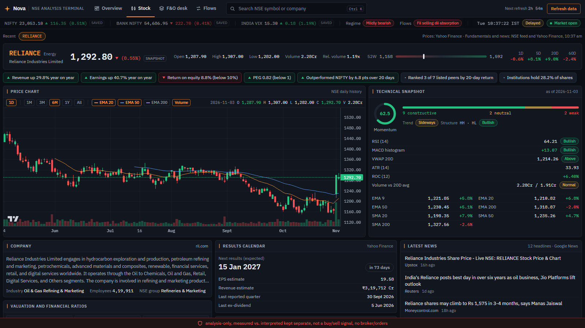
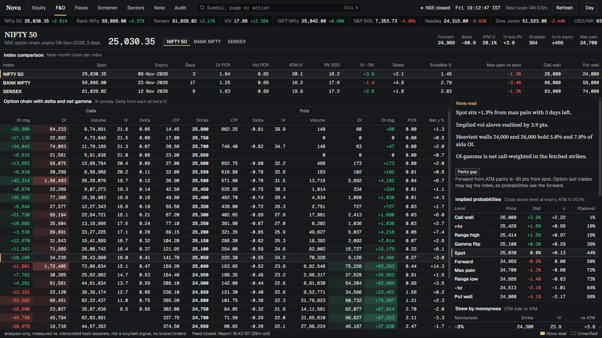
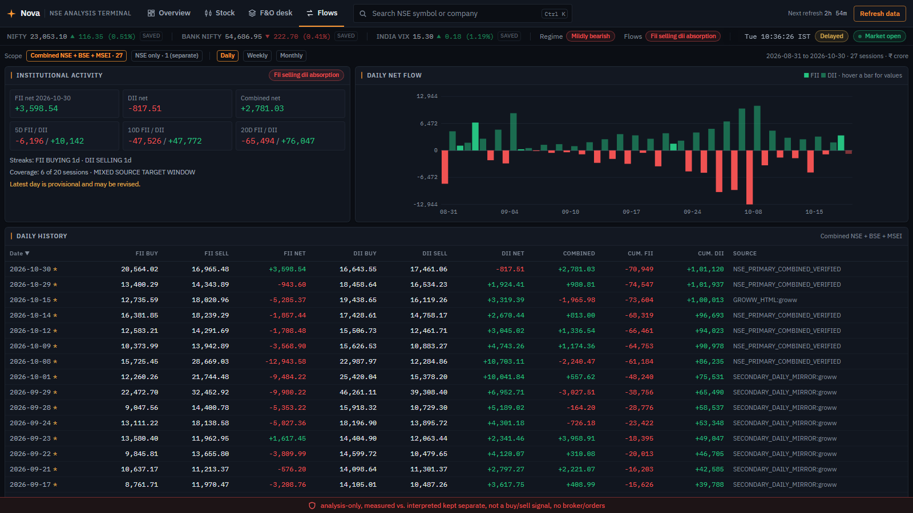
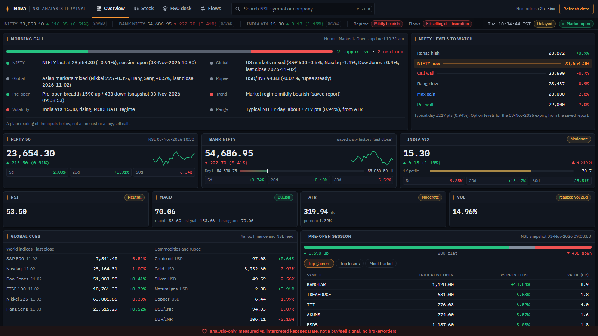

# Nova

**Indian market analysis terminal. Local. Analysis-only.**

Nova Desk is a dark, data-dense terminal for NSE equity and F&O analysis. It pulls NSE stocks, F&O option chains, FII/DII flows, live quotes, and market regime into one screen — no charts, no broker, no buy/sell signals. Measured data and interpretation are kept separate; stale or missing data is flagged, never guessed.

---

## What it is

| | |
|---|---|
| **Surface** | Nova Desk — dark institutional terminal at `http://127.0.0.1:8501` |
| **Markets** | NSE equities · NIFTY / BANK NIFTY / SENSEX F&O · FII / DII flows |
| **Data** | Price, trend structure, level map, risk & vol, valuation, ownership, quarters, peers, news |
| **Derivatives** | Option chain with delta & net gamma, parity forward, implied probabilities, skew, OI concentration, PCR, max pain, gamma flip |
| **Flows** | Rolling windows + daily ledger with per-session source (NSE primary vs mirror) |
| **Screener** | Full NSE universe (~2,300 stocks) with presets and live sector indices |
| **Live** | Watched prices stream in market hours; option chains refresh every minute |
| **Guardrail** | 100% analysis-only. `buy_sell_authorized` is hard-wired to `False`. No broker, no orders, no execution. |

---

## What it looks like

### Stock analysis — one sheet per NSE symbol


### F&O desk — NIFTY, BANK NIFTY, SENSEX


### Institutional flows — FII / DII


### Market overview


---

## Screens

**Stock analysis (F1)** — One sheet per NSE symbol: price vs Nifty, trend structure (EMA 9/20/50/200, MACD, RSI, ATR), level map in % and ATR, realized vol, beta/alpha, valuation & quality ratios, ownership, quarterly results, peers, news. Tables only.

**F&O desk (F2)** — NIFTY, BANK NIFTY, SENSEX chains: index comparison, delta and net gamma, parity forward, implied probabilities, skew by moneyness, OI concentration, PCR by distance from spot, gamma flip, unusual activity.

**Institutional flows (F3)** — FII / DII rolling windows (5D / 10D / 20D), daily ledger with source attribution, streak and correlation assessment.

**Screener (F4)** — Full NSE scan with presets (new 52W highs, RS leaders, RSI extremes, relative volume, strong up/down) and sector filter.

**Sectors (F5)** — Live NSE sector indices and equal-weight stock sectors from the latest scan.

**Market note (F6)** — One-line market read plus global cues, commodities, FX, and headlines.

**Audit (F7)** — Data flags, engine availability, and decision policy — so conflicting or stale data is visible, never hidden.

---

## Get it running

```powershell
git clone https://github.com/benalanirudh-pixel/nova.git
cd nova
python -m venv venv
.\venv\Scripts\pip.exe install -r requirements.txt
.\venv\Scripts\python.exe market_lab\market_lab_data.py   # builds the market report (~2-3 min first run)
.\venv\Scripts\python.exe web_main.py                     # opens Nova Desk at http://127.0.0.1:8501
```

Next time, just run step 4.

**Keyboard shortcuts**

| Key | Action |
|---|---|
| `Ctrl+K` or `/` | Search symbols, pages and actions |
| `F1`–`F7` | Stock analysis · F&O · Flows · Screener · Sectors · Note · Audit |
| `↑` `↓` | Move through the Monitor list |
| `R` | Run a full data refresh |

---

## Tech stack

```
NSE · BSE · Yahoo · Dhan (optional, read-only)
       │  read-only adapters
       ▼
11 Python analysis engines  →  cache-first JSON report
       │                              │
       ▼                              ▼
FastAPI (127.0.0.1:8501)  →  React 19 + TypeScript + Tailwind
REST + SSE                      custom CSS tables — no charts, no component library
```

**Engines:** technical, volatility, derivatives, institutional flow, sector, risk, event risk, research factor, market scanner.

**Data sources:** Indian Market MCP (primary), Yahoo Finance fallback, optional Dhan read-only feed (5-second index ticks, candles; no order/trade/funds endpoints). Ollama (`qwen3.5:4b`) powers AI interpretation in the desktop apps — not required for Nova Desk.

---

## Verification

`498 tests passing`, offline, no services required:

```powershell
.\venv\Scripts\python.exe -m unittest discover -s tests
```

Preflight service check (Ollama / SearXNG — warns only, never blocks):

```powershell
.\venv\Scripts\python.exe start_nova.py --check
```

---

## Guardrails

- **Analysis only.** No broker connection, no order placement, no BUY/SELL signals.
- **No invented data.** Every number shows its source and age. Stale or missing values are labelled.
- **Local only.** Server binds to `127.0.0.1`. Cross-origin writes rejected.
- **Cache-first.** The full NSE scan runs once; later runs reuse the cache.
- **No secrets in git.** Tokens live in git-ignored files (`.env`, `dhan_config.json`).

> Nova is a research tool, not investment advice. Markets carry risk. Do your own research and make your own decisions.

---

## License

[MIT](LICENSE) © 2026 Anirudh.
