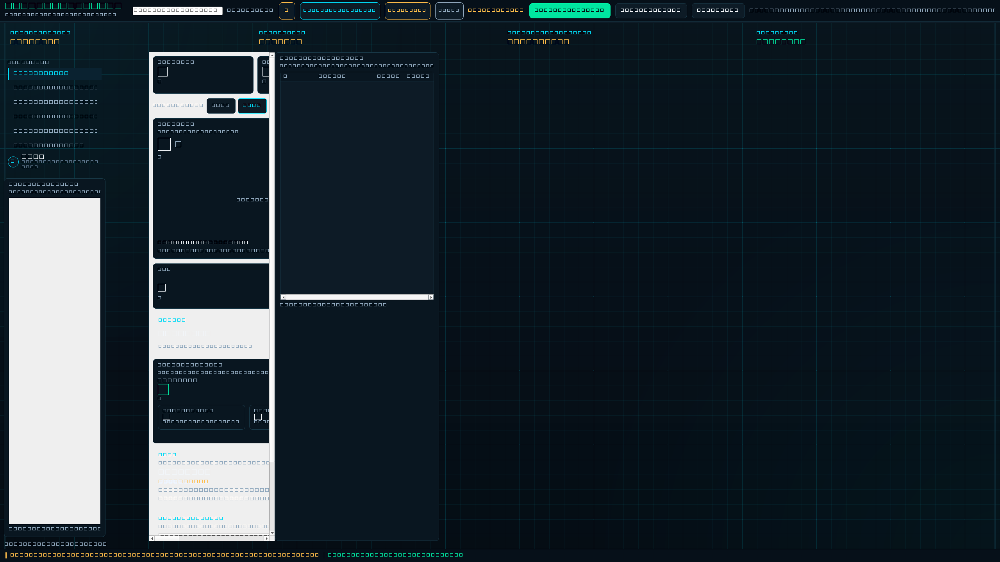
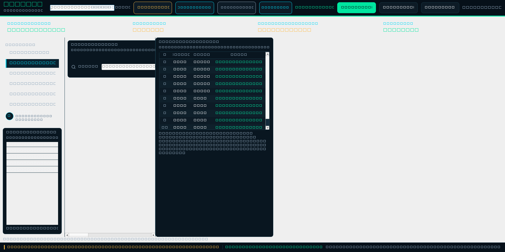
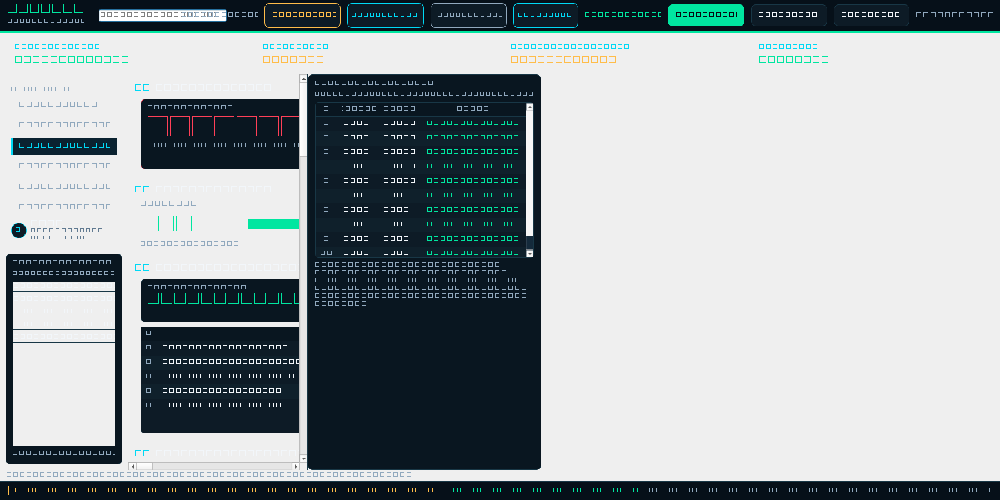
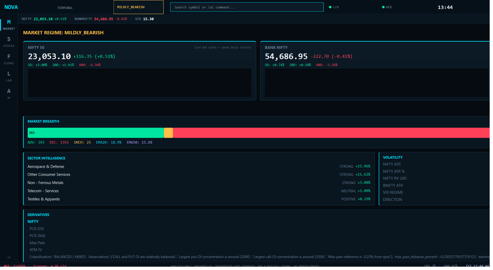
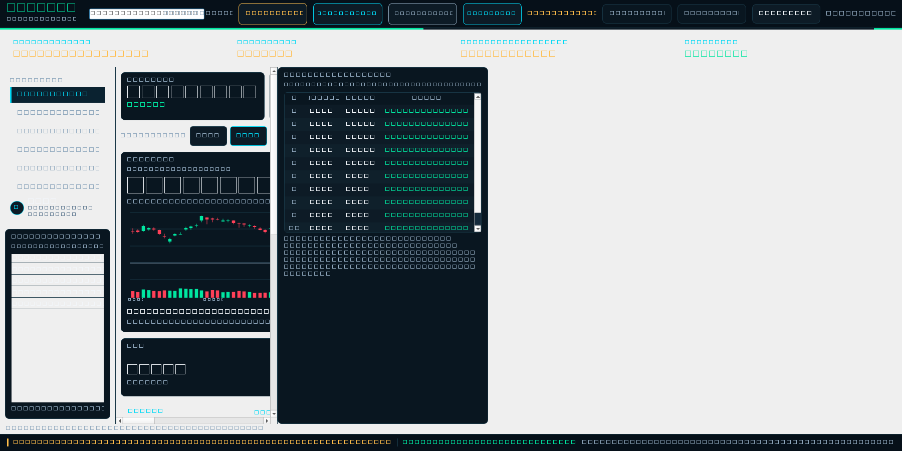

# Nova

**Real-time Indian market analysis dashboard — runs locally, no broker, no cloud.**

Nova is a web-based NSE analysis terminal built with FastAPI and React. It pulls live data from the National Stock Exchange, runs technical, derivatives, institutional flow, and regime analysis through Python engines, and renders everything in a professional trading dashboard at `http://127.0.0.1:8501`. AI interpretation is powered by a local Ollama instance. All data stays on your machine.

> **Analysis only.** Nova does not connect to any broker, place trades, or generate buy/sell signals.

---

## Dashboard

<p align="center">
  
</p>

<details>
<summary>More views</summary>

| Stock Analysis | Market Analysis (Nifty Deep Dive) |
|:---:|:---:|
|  |  |

| Desktop Terminal (PySide6) | Market Dashboard |
|:---:|:---:|
|  |  |

</details>

---

## Pages

### Overview (morning brief)
- **Morning call** — one plain line per factor (NIFTY, US/Asian markets, crude, rupee, pre-open breadth, flows, regime, VIX, typical day range, events in the next 48h), coloured supportive / neutral / cautious; never a buy/sell call
- **NIFTY levels to watch** — price ladder of the ATR day range, option call/put walls and max pain around the latest NSE print
- **Index cards** — NIFTY (live NSE print), Bank Nifty and India VIX with sparklines and 5D/20D/60D returns
- **Global cues** — S&P 500, Nasdaq, Dow, FTSE, Nikkei, Hang Seng, crude, gold, silver, gas, copper, USD/INR, EUR/INR
- **Pre-open session** — NSE pre-open breadth plus top gainers, losers and most traded at the indicative open
- **Stocks in focus** — screens over the latest scan (near 52-week high on volume, strongest momentum, unusual volume, oversold), liquid names only; rows open the stock page
- **Market news**, **last-session movers**, **FII/DII activity**, **breadth**, **sector heatmap**, **derivatives**

### Stock Analysis (research page, no charts)
- **Search-first landing** — recent and popular symbols; header search with Ctrl+K or `/`
- **Quote strip** — price, change, OHLC, volume, 52-week range, 1D/5D/20D/60D returns
- **Key takeaways** — rule-based statements from the numbers (growth, ROE, leverage, PEG, peer rank, results due)
- **Company, valuation and ratios** — P/E, P/B, PEG, EV/EBITDA, ROE, margins, growth, dividend
- **Quarterly results** — last 5 quarters with QoQ/YoY growth; **results calendar** with estimates
- **Ownership** — promoters vs institutions (FII/DII split when NSE's filing is reachable)
- **Competitors** — same-industry NSE stocks from the classification and scanner caches
- **News**, **technical snapshot** (momentum, conditions, moving averages), **corporate actions**

### F&O desk (NIFTY 50, BANK NIFTY, SENSEX)
- **Index switcher** — spot, change, PCR, max pain, ATM IV and expected move for all three at a glance
- **Metric strip** — expiry picker with days left, ATM strike, PCR (OI / volume / change in OI), max pain vs spot, ATM IV, IV minus 20-day realized vol, 3% OTM skew, ATM straddle
- **Desk read** — plain lines on positioning: PCR, fresh OI, OI range, max pain, straddle-implied move, skew, IV vs RV, trend; never a trade call
- **Levels** — call/put OI walls, max pain, straddle breakevens and floor pivots sorted around spot
- **OI profile** — put vs call open interest (or change in OI) by strike with spot, ATM and max pain marked
- **Option chain** — calls | strike | puts with OI heat, ITM shading and ATM outline
- **Volatility smile**, **spot technicals** (EMAs, RSI, ATR, realized vol, 52-week range), **India VIX regime**, **FII/DII flows**, **event risk**
- Live chains: NSE (NIFTY, BANKNIFTY) and BSE (SENSEX); refreshes every minute while the market is open

### Real-Time Updates
- **SSE (Server-Sent Events)** — Dashboard auto-updates on data refresh
- **Scheduled refresh** — Automatic data refresh on weekdays during market hours
- **Manual refresh** — One-click refresh button with POST endpoint (origin-checked)

---

## Quick Start

**Requirements:** Windows 10/11, Python 3.14, Node.js (for frontend build), Git

```powershell
git clone https://github.com/benalanirudh-pixel/nova.git
cd nova

python -m venv venv
.\venv\Scripts\pip.exe install -r requirements.txt
```

### Launch the Dashboard

```powershell
# Build frontend (first time only)
.\venv\Scripts\python.exe web_main.py --build

# Start the dashboard — opens at http://127.0.0.1:8501
.\venv\Scripts\python.exe web_main.py
```

### Development Mode

```powershell
# API only (run Vite dev server separately for hot reload)
.\venv\Scripts\python.exe web_main.py --dev

# In another terminal:
cd web/frontend && npm run dev
```

### Market Data

```powershell
# Cache-first report (fast, uses existing data)
.\venv\Scripts\python.exe market_lab\market_lab_data.py

# JSON export
.\venv\Scripts\python.exe market_lab\market_lab_data.py --json

# Full NSE scan (2,333 stocks, ~2-3 min — use sparingly)
.\venv\Scripts\python.exe market_lab\market_lab_data.py --refresh

# Service health check
.\venv\Scripts\python.exe start_nova.py --check
```

### Desktop Surfaces (Alternative)

Nova also ships PySide6 desktop UIs for offline use without a browser:

```powershell
.\venv\Scripts\python.exe terminal_main.py      # Unified Bloomberg-style terminal
.\venv\Scripts\python.exe market_lab_ui.py       # Market Lab standalone
.\venv\Scripts\python.exe main.py                # Nova Assistant (AI chat + voice)
```

---

## Architecture

```
nova/
├── web_main.py                       # Dashboard launcher (build / serve / dev)
├── web/
│   ├── api/
│   │   ├── main.py                   # FastAPI app: health, SSE, static serving
│   │   ├── report_loader.py          # Shared report cache loader
│   │   ├── scheduler.py              # APScheduler auto-refresh (weekday)
│   │   └── routes/
│   │       ├── market.py             # GET /api/market-overview
│   │       ├── stock.py              # GET /api/stock/:symbol, /api/symbols
│   │       ├── analysis.py           # GET /api/market-analysis
│   │       └── events.py             # GET /api/events (SSE stream)
│   └── frontend/
│       ├── src/
│       │   ├── App.tsx               # Shell: header, ticker tape, sidebar, routes
│       │   ├── pages/
│       │   │   ├── MarketOverview.tsx # Dashboard with all panels
│       │   │   ├── StockAnalysis.tsx  # Per-stock deep dive
│       │   │   └── MarketAnalysis.tsx # Nifty regime + derivatives analysis
│       │   ├── components/           # NewsList, FlowGauge, SectorHeatmap, ...
│       │   ├── hooks/                # useSSE, useMarketData, useStockAnalysis
│       │   └── lib/                  # API client, formatters, types, theme tokens
│       ├── package.json              # React 19, TypeScript, Vite, Tailwind
│       └── vite.config.ts
├── market_lab/
│   └── market_lab_data.py            # Central report gateway (all engines)
├── analysis/
│   └── data/                         # Python analysis engines (see below)
└── tests/                            # 423 offline tests
```

### Analysis Engines

The backend runs 11 Python analysis engines under `analysis/data/`:

| Engine | What it computes |
|--------|-----------------|
| `technical_engine.py` | RSI, MACD, ATR, EMA, ADX, trend, momentum scoring |
| `volatility_engine.py` | VIX context, realized volatility, IV, ATR regime |
| `derivatives_engine.py` | Nifty/Bank Nifty option chain: PCR, max pain, OI walls, unusual activity |
| `institutional_flow_engine.py` | FII/DII flow history with primary-source validation |
| `sector_engine.py` | Sector and macro-sector performance intelligence |
| `risk_engine.py` | Risk-budget and position-risk calculations |
| `event_risk_engine.py` | Event-risk context (earnings, expiry, policy dates) |
| `research_factor_engine.py` | Multi-factor scoring |
| `market_scanner.py` | Full NSE equity scanner (2,333 stocks) + factor ranking |
| `nse_feed.py` | Indian Market MCP adapter (primary data source) |
| `dhan_feed.py` | Optional Dhan market-data adapter (read-only, off by default) |

### Report Pipeline

`market_lab_data.py::get_market_lab_data()` aggregates all engines into a single JSON report:

1. Load cached NSE equity scan (or full scan with `--refresh`)
2. Aggregate: scanner → regime → breadth → technical → volatility → sector → derivatives → institutional → event risk → research factors
3. Optionally overlay Dhan live quotes (Nifty, Bank Nifty, VIX)
4. Cache to `analysis/data/cache/market_lab/`
5. Serve to the dashboard via FastAPI endpoints

Modes: **CACHE_FIRST** (default), **FORCED_REFRESH** (`--refresh`), **LIVE_ONLY** (`--live-only`).

### Data Sources

| Source | Adapter | Coverage |
|--------|---------|----------|
| NSE via Indian Market MCP | `nse_feed.py` | Live quotes, history, option chains, equity master |
| Yahoo Finance | `market_data.py` | Fallback for historical candles |
| NSE FII/DII endpoints | `institutional_flow_engine.py` | Daily institutional flow + Groww mirror |
| NSE archives | `derivatives_engine.py` | Option chain snapshots |
| Dhan (optional) | `dhan_feed.py` | Historical candles + live quotes; off by default |

---

## Tech Stack

| Layer | Technology |
|-------|-----------|
| **Backend** | Python 3.14, FastAPI, Uvicorn, APScheduler, SSE-Starlette |
| **Frontend** | React 19, TypeScript, Vite, Tailwind CSS |
| **Analysis** | 11 Python engines: technicals, derivatives, volatility, institutional flow, sectors, risk, regime |
| **AI** | Ollama (qwen3.5:4b) for market interpretation and stock research |
| **Data** | Indian Market MCP, Yahoo Finance, NSE, Dhan (optional) |
| **Desktop** | PySide6, QPainter (alternative offline UI) |

---

## API Endpoints

| Method | Endpoint | Description |
|--------|----------|-------------|
| GET | `/api/health` | Service health + guardrail text |
| GET | `/api/market-overview` | Cached market dashboard data (regime, breadth, flows, sectors, derivatives) |
| GET | `/api/morning-brief` | Live pre-market brief: morning call, pre-open, global cues, news, stocks in focus (5 min cache) |
| GET | `/api/stock/:symbol` | Per-stock technicals |
| GET | `/api/stock/:symbol/profile` | Company, ratios, quarterly results, results date, ownership, peers, news (15 min cache) |
| GET | `/api/symbols?q=` | Symbol search across NSE equities |
| GET | `/api/market-analysis` | Cached context for the F&O desk (VIX regime, flows, events) |
| GET | `/api/fno/:instrument?expiry=` | Live F&O desk for NIFTY, BANKNIFTY or SENSEX (60 s cache) |
| GET | `/api/events` | SSE stream (refresh events) |
| POST | `/api/refresh` | Trigger data refresh (origin-checked) |

All endpoints return JSON. The dashboard is localhost-only (`127.0.0.1`).

---

## External Services

All services run locally. No data leaves your machine.

| Service | Default URL | Purpose |
|---------|-------------|---------|
| Ollama | `http://localhost:11434` | Local LLM inference (qwen3.5:4b) |
| Indian Market MCP | stdio | NSE market data |
| SearXNG | `http://localhost:8080` | Web research (assistant only) |

---

## Tests

```powershell
# Run all 423 tests (offline, no external services needed)
.\venv\Scripts\python.exe -m unittest discover -s tests -v
```

CI (`.github/workflows/ci.yml`) runs a dependency-free gate: AST-parse every `.py` file plus stdlib-only tests. Full suite runs locally (heavy Windows stack).

---

## Safety

- **Analysis only** — No broker integration, no order placement, no trade execution, no BUY/SELL
- **No invented data** — Missing or stale data is flagged, never fabricated
- **Cache-first** — Full NSE scans only on explicit `--refresh` or empty cache
- **Guardrails** — Every surface (web and desktop) shows the analysis-only disclaimer
- **Localhost-only** — Web dashboard binds to `127.0.0.1`, POST `/refresh` is origin-checked
- **No credentials in code** — Optional Dhan token via git-ignored `.env` or `dhan_config.json`

---

## License

Private repository. All rights reserved.
