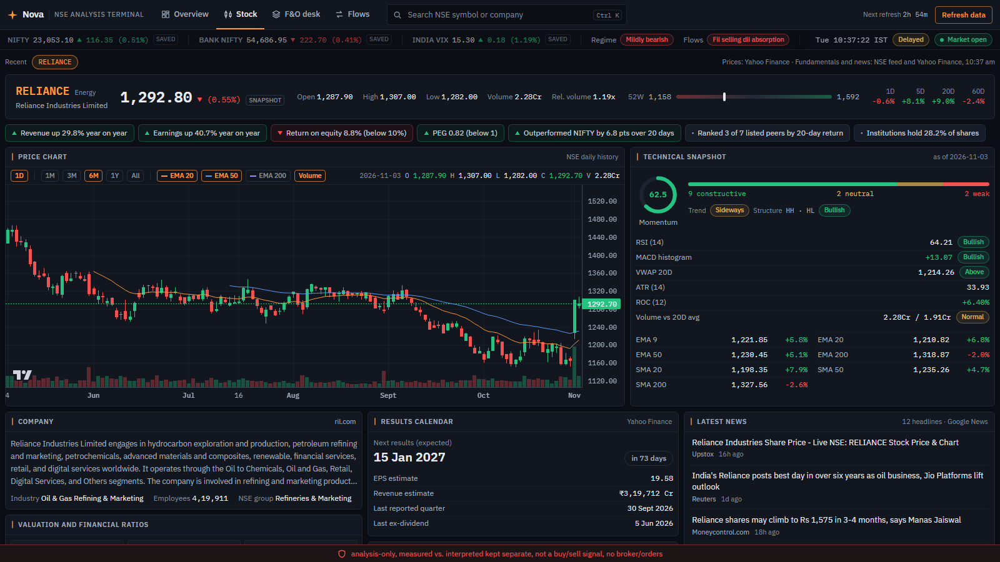
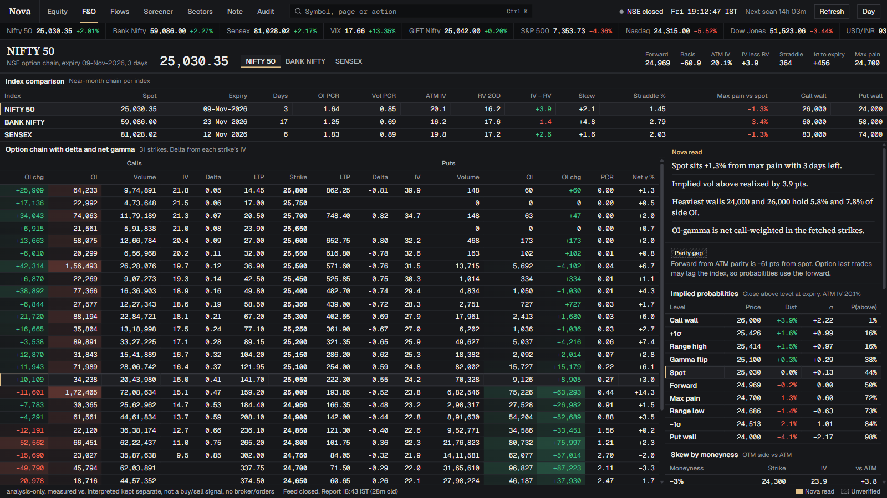
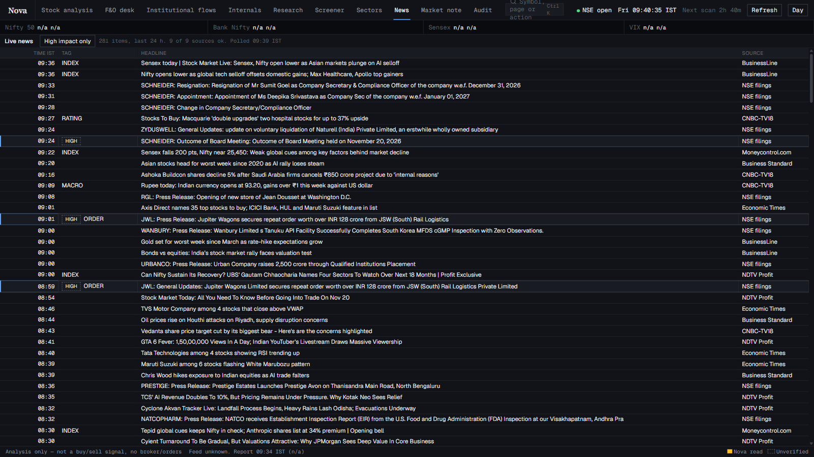
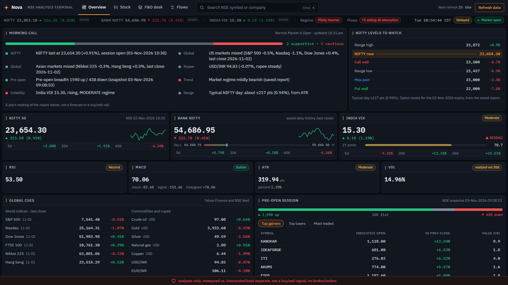

<div align="center">

# Nova

**A local, analysis-only terminal for the Indian stock market.**

NSE equities · NIFTY / BANK NIFTY / SENSEX derivatives · FII / DII flows · live market news · Telegram briefings

[](https://github.com/benalanirudh-pixel/nova/actions/workflows/ci.yml)


[](LICENSE)

</div>



Nova Desk puts the whole Indian market on one dense, keyboard-driven screen. That covers stock sheets, option chains, institutional flows, market internals, factor research, a full NSE screener and a live news wire. Telegram briefings go out before, during and after the session.

It runs on your own machine and reads public market data. **It never places orders.** Measured data and interpretation are kept apart. Every number carries its source and age. Missing or stale data is flagged, never guessed.

## Contents

- [Highlights](#highlights)
- [Screens](#screens)
- [Live news and Telegram](#live-news-and-telegram)
- [Quick start](#quick-start)
- [Configuration](#configuration)
- [Architecture](#architecture)
- [Testing](#testing)
- [Guardrails](#guardrails)
- [Documentation](#documentation)
- [License](#license)

## Highlights

| | |
|---|---|
| **Equities** | One sheet per NSE symbol. Scorecard ranked against about 2,300 stocks and against its sector. Risk (VaR / CVaR, drawdown, beta, capture). Liquidity and exit capacity. Level map in % and ATR. Valuation, ownership, quarters, peers and news. |
| **Derivatives** | NIFTY, BANK NIFTY and SENSEX chains with delta and net gamma, parity forward, implied probabilities, skew, OI concentration, PCR by distance, max pain and gamma flip. |
| **Flows** | FII / DII rolling windows (5D / 10D / 20D) and a daily ledger. Each session is tagged with its source (NSE primary or mirror). |
| **Internals** | Breadth regime with its rule shown, participation by liquidity tier, turnover concentration, sector rotation and out-of-sample factor returns. |
| **Research** | Seven factors backtested on the 500 most liquid NSE stocks since 2022, net of costs, with t-stats, rank IC and turnover. Daily breadth since 2021. |
| **News** | 9 sources polled every 60 seconds: ET, Business Standard, Mint, CNBC-TV18, NDTV Profit, BusinessLine, Google News India and NSE filings. One story from several outlets counts once, and high-impact items are tagged. |
| **Telegram** | Pre-market brief, hourly index pulse, rescan notes, post-market wrap and high-impact news, all formatted for a phone. |
| **AI read** | Optional "Ask Nova" on local Ollama (`qwen3.5:4b`). Answers are interpretations of the saved data, never trade instructions. |

## Screens

| Key | Screen | What it shows |
|---|---|---|
| `F1` | **Stock analysis** | Price chart (EMA 50/200, volume, value area), scorecard, one-year risk profile, beta / alpha against Nifty 50, liquidity, structure, levels, valuation and news |
| `F2` | **F&O desk** | Index option chains with greeks, implied probabilities, skew, PCR, max pain, gamma flip and unusual activity |
| `F3` | **Institutional flows** | FII / DII windows, daily ledger with source, streaks and correlation with Nifty |
| `F4` | **Internals** | Breadth, participation, concentration, rotation map and factor returns between saved scans |
| `F5` | **Research** | Multi-year factor backtests and breadth history from the local price store |
| `F6` | **Screener** | Full NSE universe with presets (52W highs, RS leaders, RSI extremes, relative volume) and a sector filter |
| `F7` | **Sectors** | Live NSE sector indices and equal-weight sectors from the latest scan |
| `F8` | **News** | Live market news for the last 24 h, with tags, a HIGH flag and a high-impact toggle |
| `F9` | **Market note** | One-line market read, global cues, commodities, FX and Ask Nova |
| `F10` | **Audit** | Data flags, engine availability and the decision policy, so stale or conflicting data stays visible |

`Ctrl+K` or `/` opens search for symbols, pages and actions. `R` runs a full refresh. `↑` and `↓` move through the Monitor list.

<table>
  <tr>
    <td width="50%"><br><sub><b>F&O desk</b>: chains, greeks, implied probabilities</sub></td>
    <td width="50%"><br><sub><b>Institutional flows</b>: FII / DII windows and ledger</sub></td>
  </tr>
  <tr>
    <td width="50%"><br><sub><b>News</b>: live wire with high-impact tags</sub></td>
    <td width="50%"><br><sub><b>Overview</b>: regime, breadth, derivatives, sectors</sub></td>
  </tr>
</table>

## Live news and Telegram

Nova runs its own schedule in IST. It skips NSE holidays and catches up on a missed scan at startup.

| When (IST) | What |
|---|---|
| Every 60 s | News poll. The Desk list updates around the clock. Telegram gets fresh HIGH items, Mon–Fri 08:00–20:00, at most one message a minute. |
| 08:30 daily | NSE holiday and expiry feed refresh for the event calendar |
| 09:10 | Pre-market brief: GIFT Nifty, global cues, FII / DII, upcoming events and top headlines |
| 09:20 · 12:20 · 15:35 · 18:00 | Full NSE rescan with a short Telegram note (stock count, regime, breadth) |
| 10:15 – 15:15 hourly | Index pulse: Nifty, Sensex, Bank Nifty and VIX, with the change since the last pulse |
| After the 18:00 scan | Post-market wrap: indices, internals, movers and their likely reasons, sectors and flows |
| 19:30 | Local price store update from NSE's end-of-day file |

**HIGH** news means RBI or SEBI action, results, deals, large orders, or a material NSE filing (board outcome, rating change, management change). The tags come from keywords and are labelled as such.

## Quick start

**Requirements:** Windows 10/11, Python 3.12+ (the locked venv uses 3.14), Node 20+ to rebuild the frontend. [Ollama](https://ollama.com) is optional.

```powershell
git clone https://github.com/benalanirudh-pixel/nova.git
cd nova
python -m venv venv
.\venv\Scripts\pip.exe install -r requirements.txt

# first market report (about 2-3 minutes)
.\venv\Scripts\python.exe market_lab\market_lab_data.py

# local NSE price history for Research and Internals (about 15 minutes and 400 MB, once)
.\venv\Scripts\python.exe -m analysis.data.price_store --backfill 2021-01-01

# start Nova Desk at http://127.0.0.1:8501
.\nova
```

After the first run, `.\nova` is all you need.

To rebuild the frontend after changing it:

```powershell
npm --prefix web\frontend install
npm --prefix web\frontend run build
```

<details>
<summary><b>Other entry points</b></summary>

| Command | Surface |
|---|---|
| `.\nova` or `python web_main.py` | Nova Desk, the main web terminal |
| `python start_nova.py [desk\|main\|market\|--check]` | Launcher with a preflight check (opens Nova Desk by default) |
| `python main.py` | Nova Assistant, the personal desktop AI |
| `python market_lab_ui.py` | Market Lab, a standalone Qt workbench |
| `python terminal_main.py` | Nova Terminal, the unified Qt app |

</details>

<details>
<summary><b>Running on a server</b></summary>

```powershell
pip install -r requirements-web.txt   # server-only set: no Qt, torch or audio stack
python web_main.py --host 0.0.0.0 --port 8501 --no-browser
```

- **One process only.** The scheduler and live feeds keep their state in memory.
- **Set `NOVA_REFRESH_TOKEN`.** `POST /api/refresh` and `POST /api/interpret` then need an `X-Nova-Token` header. The UI asks for it once.
- **Add TLS.** Put a reverse proxy in front; the app serves plain HTTP.

</details>

## Configuration

Every integration is off unless configured. Secrets live in git-ignored files or environment variables.

| Setting | Where | Purpose |
|---|---|---|
| `TELEGRAM_BOT_TOKEN`, `TELEGRAM_CHAT_ID` | env, or `telegram_config.json` `{"bot_token": "...", "chat_id": "..."}` | Telegram briefings and news. Check the setup with `python -m web.api.telegram`. |
| `NOVA_REFRESH_TOKEN` | env | Protects the costly POST endpoints on a shared server |
| `DHAN_CLIENT_ID`, `DHAN_ACCESS_TOKEN` | env, `.env` or `dhan_config.json` | Optional read-only Dhan market data (ticks and candles only; no order endpoints) |
| `NOVA_LIVE_INDEX_S`, `NOVA_LIVE_STOCK_S` | env | Live quote poll intervals |
| Ollama `qwen3.5:4b` | `http://localhost:11434` | Optional AI read (`ollama pull qwen3.5:4b`) |

## Architecture

```
 NSE APIs · Indian Market MCP · Yahoo / Stooq · publisher RSS · Dhan (optional)
                        │  read-only adapters
                        ▼
 analysis/data/   technical · volatility · derivatives · institutional flow · sector
                  risk · event risk · research factors · scanner · quant · price store
                        │
                        ▼
 market_lab/      cache-first JSON report  ◄──  scheduler (APScheduler, IST)
                        │                            │
                        ▼                            ▼
 web/api/         FastAPI · REST + SSE          Telegram · news feed
                        │
                        ▼
 web/frontend/    React 19 · TypeScript · Vite · custom CSS tables and SVG charts
```

| Path | Contents |
|---|---|
| `analysis/data/` | Analysis engines, data adapters and the local NSE price store |
| `market_lab/` | Report builder, view model and AI interpretation brain |
| `web/api/` | FastAPI app, routes, scheduler, live feed, news feed and Telegram |
| `web/frontend/src/desk/` | Nova Desk screens |
| `terminal/`, `ui/`, `styles/` | Qt desktop surfaces and shared design tokens |
| `tests/` | Offline unit tests (stdlib `unittest`) |
| `docs/` | Architecture, validation log, UI guide and workflow |

See [docs/ARCHITECTURE.md](docs/ARCHITECTURE.md) for the full module map.

## Testing

The 621 tests run offline and need no services or network:

```powershell
.\venv\Scripts\python.exe -m unittest discover -s tests
```

CI runs a dependency-free gate on every push to `main`: an AST parse of every file plus the stdlib-only tests. The full suite runs locally against the Windows stack.

```powershell
.\venv\Scripts\python.exe start_nova.py --check   # service preflight: warns only, never blocks
```

## Guardrails

- **Analysis only.** No broker connection, no order placement, no BUY/SELL signals. `buy_sell_authorized` is hard-wired to `False`, and a guardrail bar sits on every screen.
- **No invented data.** Every value shows its source and age. Stale, missing or conflicting data is labelled, never filled in.
- **Cache-first.** The full NSE scan runs on schedule or on request; everything else reuses the saved report.
- **Local by default.** The server binds to `127.0.0.1` and rejects cross-origin writes.
- **No secrets in git.** Tokens live in git-ignored files or environment variables.

## Documentation

| Document | Purpose |
|---|---|
| [docs/ARCHITECTURE.md](docs/ARCHITECTURE.md) | Module map and data flow |
| [docs/VALIDATION.md](docs/VALIDATION.md) | Verification log for each change |
| [docs/UI_UX_GUIDE.md](docs/UI_UX_GUIDE.md) | Nova Desk design rules |
| [docs/WORKFLOW.md](docs/WORKFLOW.md) | Development workflow |
| [CHANGES.md](CHANGES.md) | Change history |
| [AGENTS.md](AGENTS.md) | Rules for coding agents working on this repo |

## License

[MIT](LICENSE) © 2026 Anirudh

> Nova is a research tool, not investment advice. Markets carry risk; do your own research and make your own decisions.
